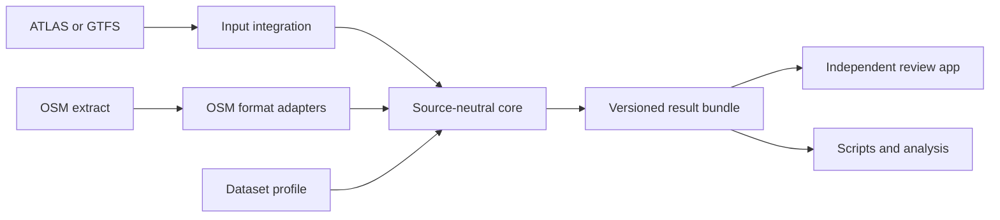

# OSM Public Transport Matcher

A Python producer package for matching public transport stops and routes against OpenStreetMap. It contains a source-neutral matching core, curated format adapters, optional acquisition clients and maintained first-party integrations. It returns complete results: matches and their evidence, unmatched entities, stop groups, discrepancies and diagnostics. It runs independently of the review website, Flask, PostGIS and any database service. Swiss GTFS preprocessing uses an embedded DuckDB database for temporary local work.

The Swiss ATLAS workflow and generic GTFS workflow use the same stop predicates. Dataset profiles define identifier mappings, grouping policies and thresholds. The project is licensed under the [MIT License](LICENSE).



## Quickstart: no downloads or database

From this directory, with Python 3.10 or later:

```bash
python -m venv .venv
source .venv/bin/activate
python -m pip install -e '.[test]'
python -m pytest tests/test_api.py tests/test_matching_regressions.py tests/test_results.py
```

The basic package depends on NumPy and SciPy. Extras add only the dependencies for the selected workflow:

| Install | Use |
|---|---|
| `.` | In-memory matching, OSM XML parsing and bundle export/validation. |
| `.[gtfs]` | Generic GTFS directory/ZIP input; adds pandas. |
| `.[swiss]` | Local Swiss ATLAS/GTFS processing; adds pandas, DuckDB and geographic dependencies. |
| `.[acquisition]` | Swiss source downloads and geographic preprocessing. |
| `.[test]` | Core tests; combine with adapter extras for the full suite. |

This example needs only the basic package:

```python
from osm_public_transport_matcher.api import match
from osm_public_transport_matcher.core.models import SourceStop, OsmNode

source = [SourceStop("my-agency", "central", 52.525, 13.369, name="Central")]
osm = [OsmNode("100", 52.52501, 13.36901, name="Central", public_transport="platform")]
output = match(source, osm)

for result in output.matched:
    print(result.source_node.key, result.osm_node.key, result.match_type, result.distance_m)
print(output.problems)
print(output.diagnostics)  # Missing route evidence is reported explicitly.
```

`SourceStop.key` includes the dataset namespace; neither SLOID nor UIC is required. OSM identities include element type. Coordinates must be finite WGS84 values. Inputs with duplicate identities or invalid positions fail before matching.

## Run a dataset and export results

A tiny synthetic GTFS example is included in `examples/`. GTFS parsing adds pandas:

```bash
python -m pip install -e '.[gtfs]'
osm-public-transport-matcher gtfs --source examples/gtfs --namespace demo --osm examples/osm.xml --output /tmp/demo-results
```

For the Swiss workflow:

```bash
python -m pip install -e '.[swiss]'
osm-public-transport-matcher swiss --source /path/to/stops_ATLAS.csv --osm /path/to/osm_data.xml --processed /path/to/processed --output /tmp/swiss-results
```

Use `osm-public-transport-matcher swiss --help` for acquisition and GTFS refresh options. Commands take explicit paths; the in-memory API never reads files, environment variables or credentials. Output directories must be new. Result writing validates a temporary bundle before publishing it.

See [the result bundle format](documentation/Result%20bundle%20format.md) for the integration contract. The review application consumes that format without importing this package.

## Versions, Git tags and deployment pins

Four identifiers are deliberately separate:

| Identifier | Example | Purpose |
|---|---|---|
| Package version | `0.1.0` | The engine release reported by Python package metadata and written as `engine_version` in result manifests. |
| Git tag | `v0.1.0` | A human-readable, annotated Git/GitHub name for the release commit. A published tag is never moved or reused. |
| Commit SHA | `0123abcd...` | The immutable source identity. Deployments pin the full SHA, even when humans refer to the corresponding tag. |
| Result schema version | `1` | The producer/consumer file contract. It changes only when the bundle format requires coordinated consumer support. |

A matching-algorithm change normally increments the package version but does not necessarily change the result schema. A breaking bundle-format change increments the schema version and requires compatible review-app support.

Release checklist:

1. Update the version in `pyproject.toml` and `src/osm_public_transport_matcher/version.py`, and update the changelog.
2. Run the full engine suite and the producer-to-consumer contract test.
3. Commit the release, then create an annotated `v<package-version>` tag on that exact commit.
4. Push the commit and tag. Never force-move an existing release tag.
5. Pin the tag's full commit SHA in each consumer (the review app's `engine.ref`) and rebuild its scheduler and documentation images.

```bash
git tag -a v0.1.0 -m "OSM Public Transport Matcher 0.1.0"
git push origin main
git push origin v0.1.0
git rev-list -n 1 v0.1.0
```

The tag is the readable release name; the SHA is the deployment lock.

## Documentation

The canonical engine documentation lives in [`documentation/`](documentation/1.%20Input%20integrations%20%26%20acquisition.md):

- [Input integrations and acquisition](documentation/1.%20Input%20integrations%20%26%20acquisition.md)
- [Stop matching](documentation/2.%20Matching%20process.md)
- [Route comparison](documentation/3.%20Routes.md)
- [Problem detection](documentation/4.%20Problems.md)
- [Result bundle format](documentation/Result%20bundle%20format.md)
- [Operations and performance](documentation/5.%20Operations%20%26%20performance.md)
- [Engine tests](documentation/6.%20Engine%20tests.md)
- [Changelog](documentation/Changelog.md)

The review application may render these pages in its combined documentation portal, but changes to engine behaviour and its documentation belong together in this package.

External datasets need no code in this package. [E1 What belongs in this distribution](documentation/1.%20Input%20integrations%20%26%20acquisition.md#what-belongs-in-this-distribution) gives the acceptance criteria for built-in adapters.

## Standalone container

Build from the repository root; its Docker build context contains no review-application code:

```bash
docker build -t osm-public-transport-matcher .
mkdir -p results
docker run --rm --user "$(id -u):$(id -g)" \
  -v "$PWD/examples:/inputs:ro" -v "$PWD/results:/results" \
  osm-public-transport-matcher gtfs --source /inputs/gtfs --namespace demo \
  --osm /inputs/osm.xml --output /results/demo
```
The image includes all supported adapter extras. Local inputs are mounted read-only; completed bundles appear in the mounted output directory. Choose a new output name for each run.

## Dataset profiles

A dataset profile (`MatchingProfile`) holds the matching policy of one dataset or agency: which identifiers are comparable, which rules run and with which thresholds. [E2 Dataset profiles](documentation/2.%20Matching%20process.md#dataset-profiles) lists every setting with its generic and Swiss values.

## Contributing

Start with [CONTRIBUTING.md](CONTRIBUTING.md). Core changes use tiny offline cases in `tests/`; UI development uses the separate review application. No national download is needed to improve a predicate. The [Swiss example](examples/swiss/expected.json) records the expected decisions for a small fixture; an adapter test compares its matches, groups, problems and route outcomes.

## Swiss processing performance

[E5.2 Pipeline performance](documentation/5.2%20Pipeline%20performance.md) explains how the Swiss processing is kept fast, its tuning settings and how to rerun the benchmark.
