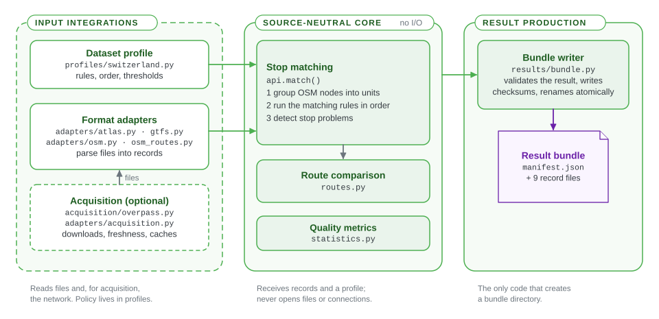

# E1 Input integrations & acquisition

This chapter explains how data enters the engine: which inputs it accepts, how they are downloaded and parsed into normalized records, and what belongs in the engine distribution. Commands on these pages run from the engine repository root.



"Engine" means the whole `osm-public-transport-matcher` package. Only its middle part, the matching core, is source-neutral. The dataset-specific work happens before it:

- **Format adapters** parse explicit input files (an ATLAS CSV, a GTFS feed, an OSM XML extract) into normalized records. They never download anything.
- **Acquisition** is an optional layer that downloads sources into a [workspace](https://github.com/openTdataCH/stop_sync_osm_atlas/blob/main/documentation/0.5%20Glossary.md#workspace) and caches prepared products.
- **Dataset profiles** hold the matching policy for a dataset family ([E2](2.%20Matching%20process.md#dataset-profiles)).

The Swiss ATLAS workflow is one such integration, maintained in the engine. It is neither a requirement of the core nor part of the review application.

For each run, the command-line tool calls one dataset runner: `swiss.py` for the Swiss data, `adapters/gtfs.py` for any other GTFS feed. The runner passes the profile and the adapters' records to the core; the command-line tool then adds the quality metrics and hands the result to the bundle writer.

## Ways to run the engine

| Situation | Command |
|---|---|
| Swiss files you already have | `osm-public-transport-matcher swiss --source stops_ATLAS.csv --osm osm.xml [--processed DIR] [--gtfs DIR [--boundary FILE]] --output DIR` |
| Download and cache Swiss sources first | `osm-public-transport-matcher swiss --download --workspace DIR --output DIR` |
| Any other GTFS feed | `osm-public-transport-matcher gtfs --source feed.zip --namespace NAME --osm extract.osm --output DIR` |
| Your own records, from Python | `osm_public_transport_matcher.match(source_stops, osm_nodes, profile)` |

Every command writes a new [result bundle](Result%20bundle%20format.md) and refuses an output directory that already exists. `--compression-level` (0–9, default 1) sets the bundle's gzip level. `osm-public-transport-matcher swiss --help` and `osm-public-transport-matcher gtfs --help` list all options.

### Swiss files

```bash
python -m pip install -e '.[swiss,test]'
osm-public-transport-matcher swiss --source /data/stops_ATLAS.csv --osm /data/osm.xml --processed /data/processed --output /results/run-001
```

- `--processed` is optional. When it contains Swiss route and GTFS identity products ([E1.2](1.2%20Swiss%20GTFS%20and%20ATLAS.md)), they are included in the result; when it does not, the missing route evidence is recorded as a diagnostic.
- OSM route products always come from the supplied XML, so no cached file can describe a different OSM snapshot.
- `--gtfs DIR` rebuilds the GTFS identity and route products from a GTFS folder. With `--boundary FILE`, GTFS stops are filtered to the Swiss boundary; without it, the stop table is taken as already selected, and the metadata records which choice was made. Matching never downloads a boundary.
- Temporary DuckDB tables and Parquet partitions are removed when the run ends.

### Download a Swiss workspace

```bash
python -m pip install -e '.[acquisition]'
osm-public-transport-matcher swiss --download --workspace /work/swiss --output /work/results/run-001
```

`--download` requires `--workspace`. Acquisition (`refresh_swiss(workspace, force=False)`) checks which sources changed, downloads and filters ATLAS, prepares the GTFS products and downloads a fresh OSM extract; the command then matches the workspace files. Without `--download`, `--workspace` alone reruns matching on the files already there.

| Path below `workspace/data` | Contents |
|---|---|
| `raw/stops_ATLAS.csv`, `raw/osm_data.xml` | The selected Swiss platforms and the OSM extract |
| `raw/switzerland.geojson`, `raw/gtfs/` | The boundary and the extracted GTFS files |
| `processed/source_routes.csv`, `source_itineraries.csv`, `source_stop_calls.csv` | Swiss source route products ([E1.2](1.2%20Swiss%20GTFS%20and%20ATLAS.md#outputs)) |
| `processed/gtfs_stops_raw.csv`, `gtfs_stop_identity_resolution.csv` | Swiss GTFS identity products |
| `cache/gtfs/*.parquet` | Parsed feed data and reduced trip patterns, reusable independently of ATLAS |
| `source_metadata.json` | Server validators, download times, file fingerprints and filter statistics |

Acquisition reuses a cached ATLAS or GTFS product only while it can prove the product current, `--force` rebuilds them all, and OSM is downloaded on every acquisition run. [E5.1 Source snapshot caching](5.1%20Source%20snapshot%20caching.md) explains the rule and the cache stages.

### Any other GTFS feed

```bash
python -m pip install -e '.[gtfs]'
osm-public-transport-matcher gtfs --source ./feed.zip --namespace agency_name --osm ./agency.osm.xml --output ./results/agency-001
```

- Stops get the keys `agency_name:<stop_id>`, routes `agency_name:route:<route_id>`. The namespace must identify the feed, stay stable between runs and contain only letters, digits, `.`, `-` and `_`.
- `stops.txt` is required. Route evidence is optional, but `routes.txt`, `trips.txt` and `stop_times.txt` must then all be present. Calls keep their numeric `stop_sequence` order, including loops and repeated stops.
- Only boarding stops (`location_type` `0` or empty) are matched. Parent stations and other location types are kept in the `gtfs_source` extension, so a station never takes the match of its own platform.
- The command declares that the OSM extract's `gtfs:route_id` tags belong to this feed. For an extract that mixes feeds, scope the evidence yourself and use the Python API.
- No SLOID, UIC number, Swiss boundary or route-year code is needed. The generic adapter reads its tables into memory; the DuckDB pattern reduction described in [E1.2](1.2%20Swiss%20GTFS%20and%20ATLAS.md#processing-a-national-feed) is specific to the Swiss feed.

## Code structure

Paths are relative to `src/osm_public_transport_matcher/`.

| Module | Responsibility |
|---|---|
| `adapters/base.py` | The public adapter contract: `AdapterResult` and `SourceAdapter` |
| `adapters/gtfs.py` | Any GTFS folder or ZIP; feed-scoped identifiers and ordered route calls; the generic runner `run_gtfs()` |
| `adapters/osm.py` | OSM stop elements, supported station ways and route evidence, into `OsmState` |
| `adapters/osm_routes.py` | OSM route masters and route relations (PTv2), without network access |
| `adapters/atlas.py`, `get_atlas_data.py`, `get_atlas_gtfs.py`, `gtfs_columnar.py` | Swiss: ATLAS records and filters, GTFS processing and GTFS-to-SLOID resolution |
| `adapters/route_products.py` | Source route products: reading cached files, route evidence, source-key scoping |
| `adapters/acquisition.py`, `adapters/source_freshness.py` | Swiss workspace refresh, cache stages and freshness checks |
| `acquisition/overpass.py` | The optional Overpass client that downloads the OSM extract |
| `integrations/swiss/` | The public entry points of the Swiss integration: `run_matching()`, `refresh_swiss()` |
| `swiss.py` | Composes the Swiss adapters, route comparison, identity extensions and input fingerprints |
| `profiles/` | Dataset profiles; the Swiss profile and its route-year normalization |


## What belongs in this distribution

The engine does not try to cover every agency or country. An external package or script can implement `SourceAdapter`, return an `AdapterResult` and call the public matching API without any change here.

A new built-in adapter or integration is accepted only when it:

- supports a broadly reused standard, or is a maintained first-party deployment of this project;
- produces normalized records with stable namespaced identities (string source IDs, a namespace without a colon) and strict coordinate and identity validation;
- keeps format parsing separate from profile policy and presentation;
- is deterministic for explicit inputs and records provenance and fingerprints;
- has no Flask, SQLAlchemy or review-database dependency, and adds no file reading, environment lookup or pandas to the core;
- keeps optional parser and download dependencies in an install extra in `pyproject.toml`;
- includes small offline test cases with at least an accepted match, an unmatched source stop, an unmatched OSM element, an ambiguous case and missing route data;
- has an identified maintainer.

One-off agency or country integrations normally live outside. They may keep source-specific fields in namespaced extensions, but no core rule may depend on them.

## Pages in this section

- [E1.1 Swiss ATLAS stops](1.1%20Swiss%20ATLAS%20stops.md)
- [E1.2 Swiss GTFS and ATLAS](1.2%20Swiss%20GTFS%20and%20ATLAS.md)
- [E1.3 OSM input and acquisition](1.3%20OSM%20input%20and%20acquisition.md)

The result bundle carries everything the review application needs; it never reads these raw or processed files. See [bundle import and publication](https://github.com/openTdataCH/stop_sync_osm_atlas/blob/main/documentation/1.1%20Bundle%20import%20and%20publication.md).

## Related pages

- [E2 Matching process](2.%20Matching%20process.md): what the core does with the normalized records
- [Result bundle format](Result%20bundle%20format.md): what every command writes
- [E5.1 Source snapshot caching](5.1%20Source%20snapshot%20caching.md): when acquisition reuses a cached source
- [A1.1 Bundle import and publication](https://github.com/openTdataCH/stop_sync_osm_atlas/blob/main/documentation/1.1%20Bundle%20import%20and%20publication.md): how the review application loads the bundle
