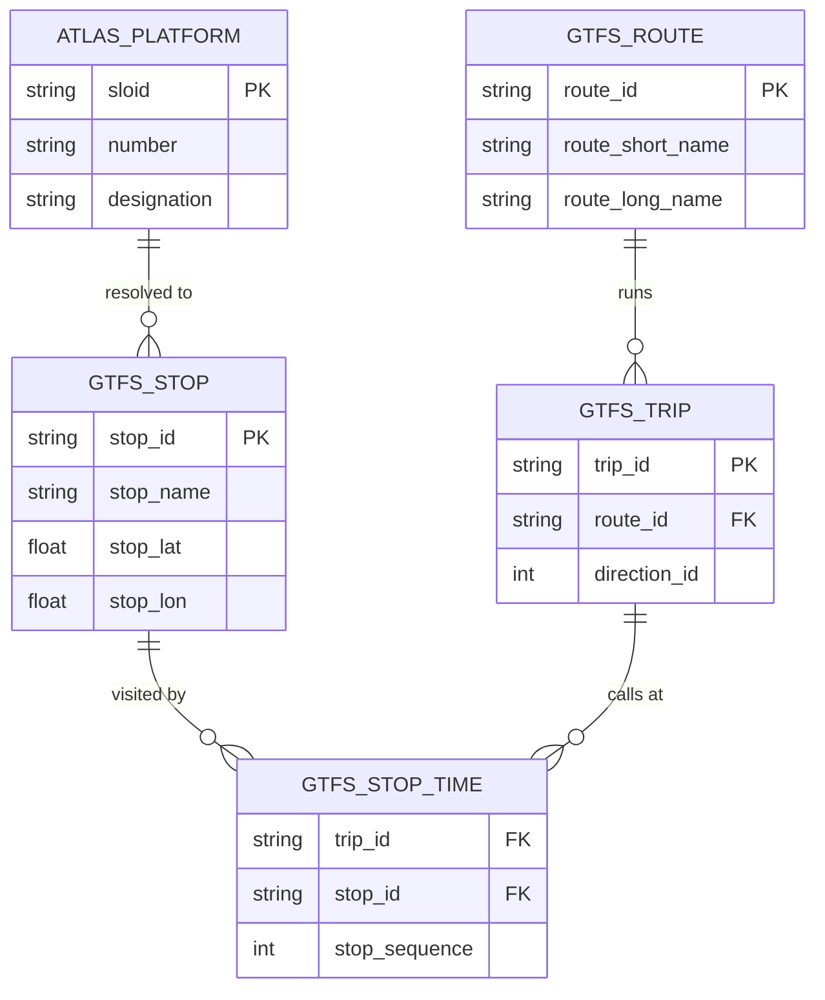
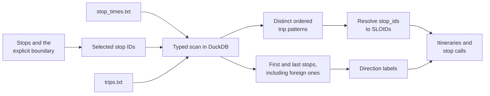

# E1.2 Swiss integration: GTFS and ATLAS

The Swiss timetable (GTFS) tells the engine which routes serve which platforms, in which order and direction. This page explains how the Swiss integration reads the national feed, resolves each GTFS `stop_id` to an ATLAS SLOID, and rebuilds lines and itineraries on the ATLAS side. These products feed [route matching](2.3%20Stop-stop%20matching%20using%20routes.md), [route comparison](3.%20Routes.md) and the review application's GTFS identity map.

The generic GTFS adapter, `adapters.gtfs.read_gtfs()`, needs none of this: no SLOIDs, no Swiss identifiers and no boundary. See [E1](1.%20Download%20and%20process%20data.md#any-other-gtfs-feed).

## The GTFS files

A GTFS feed is a ZIP of CSV files with a `.txt` extension. Four of them matter here:

| File | Holds | Used for |
|---|---|---|
| `stops.txt` | Each stop's `stop_id`, name, position, `platform_code`, `parent_station` | Identity resolution |
| `routes.txt` | Each line's `route_id`, `route_short_name`, `route_long_name`, `route_type` | Line families |
| `trips.txt` | Each journey's `trip_id`, `route_id`, `direction_id`, `trip_headsign`, `trip_short_name` | Itinerary buckets |
| `stop_times.txt` | For every trip, its stops in `stop_sequence` order | Stop calls |

To know which routes serve a stop, the tables are joined `stop_times` → `trips` → `routes`:

The Swiss path also requires the feed's `original_stop_id` and `didok` columns in `stops.txt`; they are Swiss conventions, not GTFS requirements.

## Processing a national feed

The national `stop_times.txt` has tens of millions of rows, mostly the same stop sequences repeated by many trips. The default processor (`gtfs_columnar.load_gtfs_columnar()`) therefore reduces the trips to their distinct patterns inside an embedded DuckDB database before any Python object is built:

The parsed feed is cached separately from the ATLAS mapping, so an ATLAS-only change reuses it. `GTFS_PROCESSING_BACKEND=pandas` selects the older chunked pandas reader, kept for comparisons. [E5.2](5.2%20Pipeline%20Performance.md) describes the algorithm, cache dependencies, memory settings and benchmarks.

## Resolving `stop_id` to SLOID

Every GTFS stop is resolved independently of matching with OSM. The strategies are tried in order, and the first that succeeds decides:

| # | Strategy (`resolution_method`) | Rule |
|---|---|---|
| 1 | `original_stop_id` | The feed's `original_stop_id` is itself an ATLAS SLOID. |
| 2 | `uic_platform` | Derive the UIC number from `didok`, `original_stop_id` or `stop_id`, and the platform code from the identifier or `platform_code`; map the special codes `10000` → `1` and `10001` → `2`; then find the ATLAS platform with that `(number, designation)`. |
| 3 | `coordinate_proximity` | An ATLAS platform with the same UIC number lies within 0.5 m, and the pairing is one-to-one. |
| 4 | `unique_number` | The UIC number belongs to exactly one ATLAS platform. |

In the current Swiss feed, most platform `stop_id`s are SLOIDs, for example `ch:1:sloid:3000:501:33`, so strategy 1 resolves most stops. The others cover legacy identifiers such as `8503000:0:33`, generated stop IDs and parent stations. Unresolved stops keep `resolution_method = unmatched` and still appear on the review application's identity map.

The resolution is computed once (`build_gtfs_atlas_payload()`) and reused for the route products, the identity rows and the statistics.

## From trips to itineraries

The route products do not contain one row per trip. The integration rebuilds a compact model with three levels:

1. **Line family:** one row per GTFS `route_id`.
2. **Itinerary:** one direction or variant of a family.
3. **Stop call:** one ordered stop of an itinerary.

Trips are bucketed conservatively: by `route_id` and `direction_id`, then by the representative headsign, else by `trip_short_name`, else by a hash of the ordered stop pattern at UIC level. When several patterns fall into one bucket, the most frequent one provides the itinerary's stop sequence, the platform-level SLOIDs of the others are kept as `sloid_variants`, and `trip_count` records how many trips the itinerary stands for.

### Route identifiers and timetable years

Swiss `route_id`s follow the pattern `<branch>-<line>-<project>-<version>`, where the project part encodes the timetable year, for example `-j26`. A line therefore gets a new identifier every year. `route_id_normalized` replaces the year with `-jXX` (`11-T-j26-1` becomes `11-T-jXX-1`), so a `gtfs:route_id` tag entered in OSM in an earlier year still matches. The normalizer, `normalize_route_id()`, lives in the Swiss profile.

## Outputs

The products are written to `data/processed/` in the workspace and travel in the result bundle. The `atlas_*` names belong to the Swiss cache and to the schema-1 bundle; the generic adapter uses `source_line_families`, `source_itineraries` and `source_itinerary_stop_calls` internally.

### `atlas_line_families.csv`

| Column | Meaning |
|---|---|
| `atlas_line_id` | The GTFS `route_id`, used as the family identifier |
| `route_id_normalized` | The identifier with its year code replaced by `-jXX` |
| `agency_id`, `route_short_name`, `route_long_name`, `route_desc`, `route_type` | GTFS route fields |

### `atlas_itineraries.csv`

| Column | Meaning |
|---|---|
| `atlas_itinerary_id` | Deterministic identifier from the route, direction and bucket |
| `atlas_line_id` | The family |
| `direction_id` | `0` or `1` |
| `representative_headsign` | The headsign used for bucketing and display |
| `direction_label` | First and last stop, such as `Zürich HB → Bern`; foreign termini included |
| `trip_count` | Trips represented by the itinerary |
| `shape_id` | The ordered stop identities of the representative pattern; not the GTFS `shape_id` |
| `headsign_or_pattern_hash` | The bucket key |

### `atlas_itinerary_stop_calls.csv`

| Column | Meaning |
|---|---|
| `atlas_itinerary_id` | The itinerary |
| `stop_sequence` | Order within the representative trip |
| `stop_id`, `original_stop_id` | GTFS identifiers |
| `sloid`, `mapping_method` | The resolved SLOID and the strategy that resolved it |
| `sloid_variants` | JSON list of SLOIDs merged from other patterns |
| `stop_name`, `platform_code` | GTFS label and platform |
| `location_type`, `parent_station` | GTFS hierarchy |
| `canonical_stop_key` | The SLOID when resolved, otherwise `gtfs:<stop_id>` |
| `uic_number` | Parsed UIC number |

### `gtfs_stops_raw.csv`

One row per GTFS stop, for the identity map: `stop_id`, `stop_code`, `stop_name`, `platform_code`, `original_stop_id`, `location_type`, `parent_station`, the parsed `uic_number`, the platform part of the identifier (`local_ref`) and its normalized form (`normalized_local_ref`), and `stop_lat`, `stop_lon`.

### `gtfs_stop_identity_resolution.csv`

One row per GTFS stop with its resolution:

| Column | Meaning |
|---|---|
| `stop_id`, `source_location_type` | The GTFS stop |
| `identity_level` | `platform`, `station`, `child_stop` or `stop` |
| `resolved_sloid`, `resolution_method` | The SLOID, or empty with method `unmatched` |
| `confidence` | A fixed score per strategy |
| `distance_m` | Distance for `coordinate_proximity` |
| `gtfs_stop_lat`, `gtfs_stop_lon`, `atlas_lat`, `atlas_lon` | Both positions |
| `details_json` | Further GTFS fields, such as `original_stop_id`, `platform_code` and `parent_station` |

ATLAS positions are looked up among all platforms, not only those with the stop's UIC number, because an `original_stop_id` match can point to another station.

### Statistics

The resolution statistics travel in the bundle's `gtfs_atlas_stats` extension and in the workspace's `data/source_metadata.json`:

- ATLAS coverage: `atlas.total`, `atlas.touched_by_gtfs_routes` and `atlas.coverage_percent`. Despite its legacy name, `touched_by_gtfs_routes` counts the SLOIDs that some GTFS stop resolves to.
- GTFS coverage: `gtfs_stop_ids.total`, `matched_to_atlas`, `unmatched` and `coverage_percent`.
- Assignments per strategy: `assignments.original_stop_id`, `strict`, `coordinate_proximity` and `unique_number_fallback`.
- Diagnostics of the proximity strategy, cardinality and reasons for unresolved stops.

The engine exports the values; it does not quote them in its documentation. The review application writes them to `data/gtfs_atlas_stats.json` and its analytics after import.

## Code

| Function | In | Does |
|---|---|---|
| `load_gtfs_columnar()` | `adapters/gtfs_columnar.py` | Default feed processing in DuckDB |
| `load_gtfs_data_streaming()` | `adapters/get_atlas_gtfs.py` | The pandas comparison path |
| `build_gtfs_atlas_payload()` | `adapters/get_atlas_gtfs.py` | Identity resolution, reused everywhere |
| `match_gtfs_to_atlas()` | `adapters/get_atlas_gtfs.py` | The four strategies |
| `build_integrated_gtfs_data_streaming()` | `adapters/get_atlas_gtfs.py` | Joins the resolved stops with routes |
| `build_gtfs_db_payload_rows()`, `write_gtfs_db_payload_cache()` | `adapters/get_atlas_gtfs.py` | Identity rows and their CSV files |
| `write_atlas_route_csvs()` | `adapters/get_atlas_gtfs.py` | The route product CSV files |
