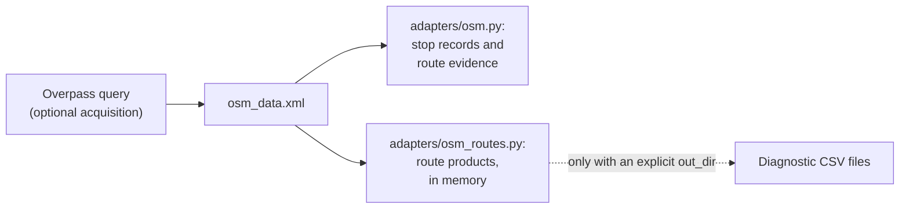

# E1.3 OSM input and acquisition

OpenStreetMap provides the other side of every comparison: the stop elements and the route relations. This page explains which OSM data the engine downloads, which elements it keeps, and how one XML extract becomes stop records, route evidence and route products.

Three modules share the work:

1. `acquisition/overpass.py` optionally downloads one XML extract from the Overpass API.
2. `adapters/osm.py` parses the stop elements and their route memberships into `OsmNode` records and an `OsmState`.
3. `adapters/osm_routes.py` builds the route products (route masters, route relations, members and stops), keeping the PTv2 structure.



Both adapters read the same explicit file and never access the network.

## The download

| Property | Value |
|---|---|
| Endpoint | `https://overpass-api.de/api/interpreter`, or `OVERPASS_API_URL`: one URL or a comma-separated list, tried in order |
| Area | Switzerland, `ISO3166-1=CH` |
| Request | Overpass QL in the body of a POST (`text/plain; charset=utf-8`), with the user agent `OVERPASS_USER_AGENT` |
| Timeouts | 30 s to connect, 600 s to read; the query itself asks for at most 360 s |
| Validation | The answer must parse as an `<osm>` document without a `<remark> runtime error: …</remark>`. Overpass reports a query timeout or memory exhaustion that way, inside an HTTP 200 answer, after any partial data |
| Retries | HTTP 429, 502, 503 and 504, connection failures, timeouts and answers that fail validation are retried `OVERPASS_MAX_RETRIES` times per endpoint (default 2), waiting `OVERPASS_RETRY_BACKOFF_SECONDS` (default 5 s) and doubling the wait each time. Any other HTTP error moves on to the next endpoint at once |
| Data time | The answer's `<meta osm_base="…">`, the time of the newest OSM edit the server had, is recorded as `osm_data_at` in the acquisition metadata. `last_overpass_query_at` is when the query ran |

Only a validated answer is written and replaces `data/raw/osm_data.xml`. When every endpoint has failed, `osm.download` raises one error that lists each endpoint's last failure and its number of attempts, for example `Overpass request failed: https://overpass-api.de/api/interpreter: HTTP 504 (3 attempts)`, and the run stops; the previously published result is untouched. The text of an Overpass error page goes to the log only.

The complete query:

```overpassql
[out:xml][timeout:360];
area["ISO3166-1"="CH"]->.searchArea;

(
  node(area.searchArea)["public_transport"~"platform|stop_position|station|halt|stop"];
  node(area.searchArea)["railway"="tram_stop"];
  node(area.searchArea)["amenity"="ferry_terminal"];
  node(area.searchArea)["amenity"="bus_station"];
  node(area.searchArea)["highway"="bus_stop"];
  node(area.searchArea)["railway"="halt"];
  node(area.searchArea)["railway"="station"];
  node(area.searchArea)["aerialway"="station"];
  node(area.searchArea)[~"^(disused|abandoned|removed|demolished|razed|destroyed|was):(public_transport|railway|amenity|highway|aerialway)$"~"^(platform|stop_position|station|halt|stop|tram_stop|ferry_terminal|bus_station|bus_stop)$"];
)->.pt_nodes;

(
  way(area.searchArea)["aerialway"="station"]["public_transport"="station"];
  way(area.searchArea)["uic_ref"];
)->.candidate_ways;

(
  relation(bn.pt_nodes)[type=route][route!=hiking];
  relation(bw.candidate_ways)[type=route][route!=hiking];
)->.seed_routes;

relation(br.seed_routes)[type=route_master]->.route_masters;

(
  .seed_routes;
  relation(r.route_masters)[type=route][route!=hiking];
)->.routes;

.pt_nodes out body qt;
.candidate_ways out body center qt;
.routes out meta;
.route_masters out meta;
```

It returns the stop nodes, including [disused](#disused-stops) ones, the candidate station ways with their centre points, every non-hiking route relation that contains one of them, the route masters of those relations, and the other route relations of those route masters.

## Which elements are stops

| Tag | Values |
|---|---|
| `public_transport` | `platform`, `stop_position`, `station`, `halt`, `stop` |
| `railway` | `tram_stop`, `halt`, `station` |
| `highway` | `bus_stop` |
| `amenity` | `ferry_terminal`, `bus_station` |
| `aerialway` | `station` |

The query's eight stop lines are generated from these selectors, `STOP_TAG_SELECTORS` in `core/osm_tags.py`.

Besides nodes, the engine keeps two kinds of ways as stops, each represented by its centre point:

1. `aerialway=station` with `public_transport=station`;
2. ways with a `uic_ref` that no active node already carries; a disused node never hides such a way.

They get identities such as `way_123` (key `osm:way:123`) and are matched like nodes. OSM pairs and trios are built from nodes only. Station elements are kept but excluded from matching ([E2](2.%20Matching%20process.md#rules-shared-by-all-matching-rules)).

### Disused stops

An element is disused when a stop tag carries an OSM lifecycle prefix for a past state: `disused:`, `abandoned:`, `removed:`, `demolished:`, `razed:`, `destroyed:` or `was:`, as in `disused:highway=bus_stop`. The prefixed key can be any key of the table and the value any value of the table, compared exactly. Prefixes for future features, `construction:` and `proposed:`, are not recognized.

The last line of `.pt_nodes` downloads these elements even when every stop tag is prefixed, and their route relations are seeded like any stop's. Its two patterns, `LIFECYCLE_KEY_PATTERN` and `LIFECYCLE_VALUE_PATTERN`, are built from `STOP_TAG_SELECTORS` and also classify the parsed elements, so what is downloaded and how it is classified cannot drift apart.

`lifecycle_of()` records the prefix as the element's `lifecycle`; when several prefixes occur, the first in the order above wins. A disused element never takes part in matching, even when an unprefixed stop tag remains ([E2](2.%20Matching%20process.md#rules-shared-by-all-matching-rules)). It gets a `disused` problem only when it still needs attention ([E4.1](4.1%20Stop%20Problems.md#disused-problems)).

## Stop records

`adapters.osm.read_osm(xml_path)` turns every stop element into an `OsmNode`:

| Field | From | Used for |
|---|---|---|
| `node_id` | The node ID, or `way_<id>` | Identity |
| `lat`, `lon` | The node position, or the way centre | Spatial matching, maps |
| `local_ref` | `local_ref`, else `ref` | Telling platforms apart |
| `name` | `name` | Name matching, labels |
| `uic_name` | `uic_name` | Name matching and grouping |
| `uic_ref` | `uic_ref` | Exact matching, grouping, route stop identity |
| `network`, `operator` | Same-named tags | Display; the operator attribute problem |
| `public_transport`, `railway`, `amenity`, `aerialway` | Same-named tags | Grouping and element type |
| `tags` | All tags | Further fields such as `gtfs:name`, `operator:wikidata`, `network:wikidata` |
| `lifecycle` | `lifecycle_of(tags)`: the lifecycle prefix of a stop tag, such as `disused`; `None` for active elements | Keeping [disused stops](#disused-stops) out of matching |

Element type is part of the identity, so a node and a way with the same number stay distinct, and so do co-located elements.

## Route evidence for stop matching

While reading the XML, `read_osm()` also records, for every stop element, the route relations it belongs to:

- **Route memberships** with the relation's `gtfs:route_id`, its normalized form and a direction. The direction comes from the `ref_trips` tag: a trip id ending in `.H` is direction `0`, `.R` direction `1`. A relation without either suffix is recorded for both directions, so that its route identifier can still match.
- **Direction names**, such as `Seeplatz → Spital`: the names of the relation's first and last members, attached to every member.

The [route rule](2.3%20Stop-stop%20matching%20using%20routes.md) and the route-contradiction problem use this evidence.

## Route products

`process_osm_routes_data(xml_text, out_dir=None)` builds the OSM side of [route comparison](3.%20Routes.md) in memory, keeping the PTv2 hierarchy. The Swiss runner always builds them from the current XML. With an explicit `out_dir`, the same frames are also written as diagnostic CSV files, named below; normal runs do not write them.

| Product | One row per | Principal columns |
|---|---|---|
| `osm_route_masters` | `type=route_master` relation | `route_master_id`, `route_master` (mode), `name`, `ref`, `operator`, `operator_wikidata`, `network`, `network_wikidata`, `colour`, `gtfs_route_id`, `is_non_gtfs` |
| `osm_route_relations` | `type=route` relation: one itinerary | `relation_id`, `route` (mode), `name`, `ref`, operator and network fields, `from_name`, `to_name`, `via`, `public_transport_version`, `colour`, `gtfs_route_id`, `gtfs_trip_id`, `gtfs_trip_id_sample`, `gtfs_shape_id`, `route_master_id`, `family_origin`, `synthetic_family_key` |
| `osm_route_master_tags`, `osm_route_relation_tags` | tag | Key and value |
| `osm_route_master_members` | member of a route master | The ordered route relations |
| `osm_route_relation_members` | member of a route relation | `member_type`, `member_ref`, `member_role`, `member_sequence`, `resolved_node_id`, derived direction |
| `osm_route_relation_stops` | stop member of a route relation | See below |

`is_non_gtfs` is true when the `network` tag is `FlixBus` (in any letter case): such routes are not in the Swiss timetable. They are skipped by family matching and listed on the review application's non-GTFS routes tab.

`osm_route_relation_stops` is the OSM source of stop calls:

| Column | Meaning |
|---|---|
| `relation_id` | The route relation |
| `direction_id` | From `ref_trips`, when available |
| `stop_sequence` | Order of the member |
| `osm_node_id` | The member's node or way identity |
| `stop_role` | The member role, such as `stop` or `platform` |
| `canonical_stop_key` | `uic:<uic_ref>` when available, otherwise `osm:<node_id>` |
| `stop_label` | The best available name |
| `uic_ref`, `stop_lat`, `stop_lon` | Copied from the member |

Stop members without a supported position are left out of the stop calls and counted in the `unsupported_or_external_osm_route_members` diagnostic, with sample identities. The fingerprinted XML still contains them.

## Tags the engine relies on

| Tag | Purpose | Used by |
|---|---|---|
| `uic_ref` | Station identity | Exact matching, grouping, route stop identity |
| `name`, `uic_name`, `gtfs:name` | Stop names | Name matching |
| `local_ref` | Platform code | Exact, name and distance rules |
| `gtfs:route_id` | Link to a GTFS route | Route matching and route comparison |
| `ref_trips` | Direction | Route matching and route comparison |
| `operator`, `network` | Line metadata | Route families, the operator attribute problem |

## Limits

Ways are represented by one point; full polygon geometry is not compared. Relations are not stop elements. The number of elements with route evidence can be read from the bundle's `route_evidence` extension.

## Code

| Element | Location |
|---|---|
| Download | `query_overpass()` and `build_public_transport_query()` in [acquisition/overpass.py](../src/osm_public_transport_matcher/acquisition/overpass.py) |
| Stop tags and lifecycle prefixes | `STOP_TAG_SELECTORS`, `LIFECYCLE_PREFIXES`, `lifecycle_of()` and `has_active_stop_tag()` in [core/osm_tags.py](../src/osm_public_transport_matcher/core/osm_tags.py) |
| Stop records and route evidence | `read_osm()` in [adapters/osm.py](../src/osm_public_transport_matcher/adapters/osm.py) |
| Route products | `process_osm_routes_data()` in [adapters/osm_routes.py](../src/osm_public_transport_matcher/adapters/osm_routes.py) |
