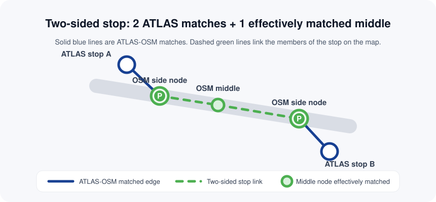
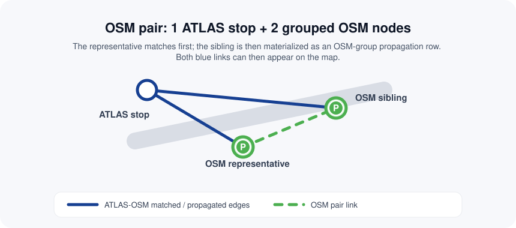
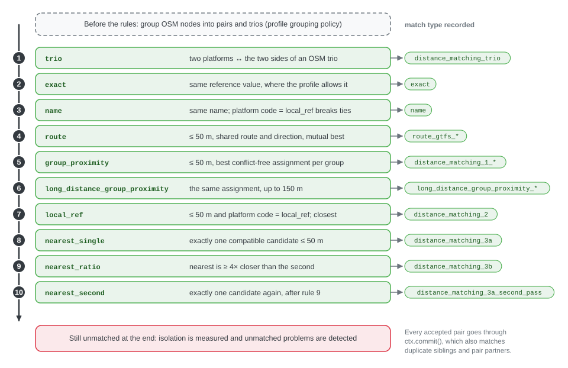
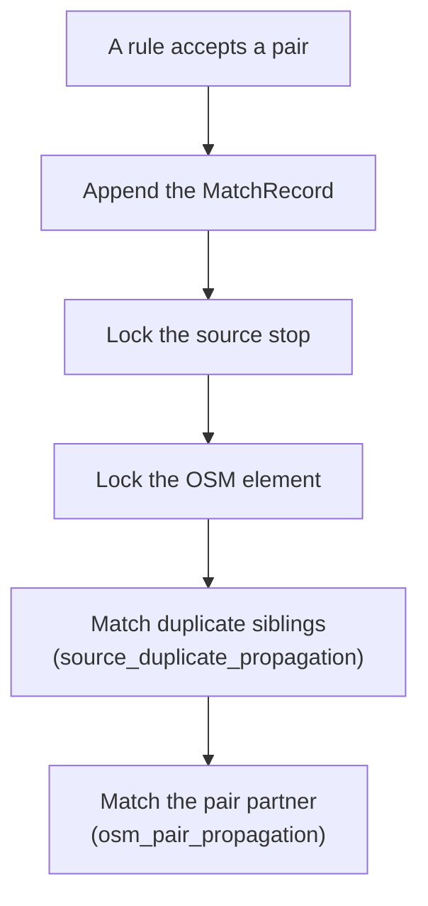

# E2 Matching process

This chapter explains how the engine decides which OpenStreetMap element represents each source stop: the inputs it works on, the dataset profile that configures it, how OSM nodes are grouped first, the fixed order of the matching rules and what a match records. Each family of rules has its own page: [E2.1 Reference](2.1%20Reference%20matching.md), [E2.2 Name](2.2%20Name%20matching.md), [E2.3 GTFS route](2.3%20GTFS%20route%20matching.md) and [E2.4 Distance](2.4%20Distance%20matching.md).

The matching core is source-neutral. ATLAS is one source among others; the rules below apply to any feed, and the dataset profile switches the Swiss-specific behaviour on.

## One call

The public entry point is `osm_public_transport_matcher.match(source, osm, profile)`:

```python
from osm_public_transport_matcher import match
from osm_public_transport_matcher.core.models import SourceStop, OsmNode
from osm_public_transport_matcher.profiles import MatchingProfile

result = match(
    [SourceStop(namespace="agency", source_id="A", lat=48.0, lon=2.0, name="Central")],
    [OsmNode(node_id="1", lat=48.0, lon=2.0, name="Central", public_transport="platform")],
    MatchingProfile(),
)
```

The example needs no database, network or file. `match()` copies its inputs into fresh per-run state, so separate calls never share matches or route state. It then works in four steps:

1. **Build the state.** Disused OSM elements and elements kept only for their identifier are [set aside](#rules-shared-by-all-matching-rules); `SourceState` and `OsmState` index the remaining records by key, reference, name and position.
2. **Group OSM elements** into stop units (pairs and PTv2 two-sided stops), when the profile enables grouping.
3. **Run the matching rules** in the profile's order. Each rule only sees stops that are still unmatched.
4. **Detect problems** on every match, every unmatched entity and every disused OSM element, and return a complete `MatchingOutput`.

The dataset runners wrap this call: `swiss.run_matching()` for ATLAS and `adapters.gtfs.run_gtfs()` for GTFS feeds run the adapters first, then compare routes ([E3](3.%20Routes.md)) and attach their extensions. The CLI writes the result as a [result bundle](Result%20bundle%20format.md).

## Records and state

| Component | Holds |
|---|---|
| `SourceStop` | One source stop: the key `namespace:source_id`, position, name, platform code, station reference, operator, references, parent and extensions |
| `Reference` | One identifier of a stop: namespace, value and scope (`stop` or `station`) |
| `OsmNode` | One OSM element: typed identity (`osm:node:1`, `osm:way:1`), position and tags |
| `SourceState` | The source records, their duplicate groups, optional route evidence and the matched keys |
| `OsmState` | The OSM records with reference and name indexes, stop units, used elements and a lazy spatial index |
| `RouteState` | Per-run route equivalences built from normalized route products |
| `MatchingProfile` | The dataset profile, described next |

Parsing belongs in adapters. For ATLAS, `adapters.atlas` maps `sloid` to `source_id`, `designationOfficial` to `name`, `designation` to `platform_code` and `number` to `station_ref`, and adds two references: the SLOID (scope `stop`) and the UIC number (scope `station`). It also prepares the duplicate groups. A GTFS adapter uses its own namespace and never infers UIC numbers from arbitrary `stop_id` strings. Co-located OSM elements stay distinct records.

## Dataset profiles

A dataset profile, `MatchingProfile` in `core/profile.py`, holds the matching policy of one dataset. The rules themselves contain no dataset-specific knowledge; the profile decides which evidence they may use and how strict they are. The engine ships `profiles.SWITZERLAND` (`profiles/switzerland.py`); generic GTFS feeds use the default settings, with the profile ID `gtfs:<namespace>` and the `routes` capability added.

| Setting | Default (generic) | Switzerland | Effect |
|---|---|---|---|
| `identifier_rules` | none | ATLAS SLOIDs ↔ OSM `ref:sloid` and `railway:ref:sloid` | Which OSM tags name the exact source stop ([E2.1](2.1%20Reference%20matching.md#identifier-matching-identifier)) |
| `reference_rules` | none | ATLAS `uic` station references ↔ OSM `uic_ref` | Which identifiers count as reference evidence ([E2.1](2.1%20Reference%20matching.md)) |
| `station_reference_matching` | off | on | Allows station-level reference links, including one-to-many and many-to-one |
| `osm_station_ref_tag` | `uic_ref` | `uic_ref` | OSM tag read as the station reference; the OSM tags are not rewritten. It takes effect only where a station-scoped `ReferenceRule` for this tag permits the comparison (`allows_station_reference()`) |
| `predicate_names` | all eleven rules, in the order below | same | Which rules run, and in which order |
| `osm_grouping` | off | on | Builds OSM pairs and two-sided stops before the rules |
| `grouping` | 12, 15, 15 and 30 m; ratios 1.5 and 2.0 | same | Grouping distances, explained below |
| `max_distance` | 50 m | 50 m | Distance limit of the route, group, local-reference and nearest rules |
| `long_distance` | 150 m | 150 m | Distance limit of the long-distance group rule, and the farthest an identifier may name a stop |
| `name_match_max_distance` | 1000 m | unlimited | Distance limit of name matches |
| `ratio_factor`, `ratio_min_second_distance` | 4 and 10 m | same | Ratio test of the nearest-candidate rule |
| `preserve_name_alias_multiplicity` | off | on | Indexes an element once per name tag even when the values are equal ([E2.2](2.2%20Name%20matching.md)) |
| `isolation_radius` | 50 m | 50 m | Radius of the isolated flag |
| `distance_priorities` | 80, 25 and 15 m | same | Distance problem thresholds for P1, P2 and P3 ([E4.1](4.1%20Stop%20problems.md)) |
| `distance_priority_exempt_operators` | none | `SBB` | Operators whose distance problems are at most P3 |
| `problem_name_tags` | `name`, `uic_name` | `uic_name` | OSM tags compared by the attribute problem |
| `itinerary_require_direction` | off | on | Itinerary matches need a known, equal direction ([E3.2](3.2%20Route-route%20matching.md)) |
| `itinerary_min_stop_ratio` | 0.8 | 0.8 | Share of the longer stop list two itineraries must share in order |
| `capabilities` | `stops`, `problems` | adds `routes` | Capabilities the profile can advertise |

The complete profile is written into every bundle's metadata, so a result always records the policy that produced it. To support another dataset, create a profile with its reference rules and thresholds rather than changing a rule. In this example, a city feed's stop IDs count as references only against OSM elements whose `gtfs:feed` tag names that feed:

```python
from osm_public_transport_matcher import MatchingProfile, Reference, ReferenceRule, SourceStop

profile = MatchingProfile(
    profile_id="city-transit",
    reference_rules=(ReferenceRule(
        namespace="city-transit-stop", osm_tag="gtfs:stop_id", scope="stop",
        source_namespace="city-transit",
        osm_scope_tag="gtfs:feed", osm_scope_value="city-transit",
    ),),
    max_distance=40,
)
stop = SourceStop("city-transit", "101", 52.5, 13.4,
    references=(Reference("city-transit-stop", "101", "stop"),))
```

## OSM grouping before the rules

OSM's public transport scheme, **PTv2** (Public Transport Version 2), maps a stop with two roles: a `public_transport=platform` element where passengers wait, and a `public_transport=stop_position` node where the vehicle stops. When the profile enables grouping, `OsmState.build_groups()` combines such nodes into **stop units** before any rule runs, so that a rule matches the unit as a whole. Ungrouped elements stay single units. The group types that rely on PTv2 roles carry the `ptv2_` prefix.

Grouping runs in two passes:

1. **Two-sided stops** (`ptv2_two_sided_stop`) first: one stop position with an element on each side. For a UIC number with exactly three OSM nodes, exactly one of them a `stop_position`, and exactly two ATLAS platforms, the two other nodes become the sides and the stop position the middle. Both sides must lie within 15 m of the middle (`two_sided_middle_distance`); otherwise the nodes stay available for pairs.
2. **Pairs** second: a platform-like node and a `stop_position` that are each other's nearest neighbour form a pair. The platform is the representative.

| Group type | Representative | Partner | Rule |
|---|---|---|---|
| `ptv2_two_sided_stop` | One side node | The other side and the middle (`middle` and `side` member roles) | As described above |
| `ptv2_pair_uic_ref_equal_count` | `public_transport=platform` | `stop_position` | Same UIC number, equal counts of platforms, stop positions and nearby ATLAS platforms; reciprocal nearest neighbours within 15 m |
| `ptv2_pair_uic_ref` | `public_transport=platform` | `stop_position` | Same UIC number; reciprocal nearest neighbours within 12 m, with a ratio test |
| `ptv2_pair_name_equal_count` | `public_transport=platform` | `stop_position` | Like `ptv2_pair_uic_ref_equal_count`, for nodes found by name and anchored to a UIC number |
| `ptv2_pair_name` | `public_transport=platform` | `stop_position` | Like `ptv2_pair_uic_ref`, for nodes found by name |
| `tram_stop_pair_equal_count` | `railway=tram_stop` | `stop_position` | Like `ptv2_pair_uic_ref_equal_count`, for tram stops |
| `tram_stop_pair` | `railway=tram_stop` | `stop_position` | Like `ptv2_pair_uic_ref`, for tram stops |

How the pairing decides, for UIC, name and tram groups alike:

1. Pairs are always **reciprocal** nearest neighbours: each node is the other's closest candidate.
2. When platforms, stop positions and nearby ATLAS platforms have equal counts, the **equal-count** branch (`*_equal_count`) pairs within 15 m without a ratio test, and only when every platform and stop position finds its partner. Only ATLAS platforms whose nearest same-UIC OSM node is within 30 m count as nearby.
3. Otherwise, a candidate within 12 m must be at least 1.5 times closer than the second-nearest candidate (wherever that is; a missing second candidate passes). These pairs are accepted only when grouped and ungrouped OSM entities then add up exactly to the UIC's ATLAS platform count.
4. If that complete-count check fails, pairing is retried with a ratio of 2.0 and the reciprocal pairs found are kept, even if the set is incomplete.



A two-sided stop's two sides are its only real matches. Its middle stop position stays unmatched during matching and is marked [effectively matched](https://github.com/openTdataCH/stop_sync_osm_atlas/blob/main/documentation/0.5%20Glossary.md#effectively-matched) when both sides are matched.



For a pair, the representative is matched first and the commit gives its partner an `osm_pair_propagation` match.

After grouping, lookups such as `get_by_name()` and `batch_query_radius()` return representatives and hide their partners. In the lookups of the reference and group rules (`get_all_unmatched_grouped()`), a representative is also listed under its partners' tag values, so a unit stays findable when only its partner carries the UIC number or name.

## The matching rules



The rules run in this order. Each sees only the source stops that are still unmatched; once a pair is committed, both sides are locked.

Each match type names the evidence that decided it, so a match type says how a pair was found without looking up the rule. The prefix of an identifier or reference match type is the namespace of the profile's rule: `sloid` and `uic` for Switzerland.

| # | Rule | Class | Match types | Accepts |
|---|---|---|---|---|
| 1 | `identifier` | [`IdentifierPredicate`](2.1%20Reference%20matching.md#identifier-matching-identifier) | `sloid_identifier` | Every element whose identifier tag names a source stop within 150 m, such as `ref:sloid`; any number of elements per stop. |
| 2 | `two_sided_stop` | [`TwoSidedStopPredicate`](2.1%20Reference%20matching.md#two-sided-stops-two_sided_stop) | `uic_two_sided_stop` | For a two-sided stop whose UIC number has exactly two unmatched ATLAS platforms, the assignment of platforms to sides with the smaller total distance. The middle stays unmatched. |
| 3 | `reference` | [`ReferencePredicate`](2.1%20Reference%20matching.md) | `uic_reference_one_osm`, `uic_reference_one_source`, `uic_reference_local_ref` | The same reference value, where a profile reference rule allows the comparison: one OSM element for the value, one source stop for the value, or platform code equal to `local_ref`. |
| 4 | `name` | [`NamePredicate`](2.2%20Name%20matching.md) | `name_one_osm`, `name_local_ref` | The same name in `name`, `uic_name` or `gtfs:name`: the only candidate, or the one whose `local_ref` equals the platform code. |
| 5 | `gtfs_route` | [`GtfsRoutePredicate`](2.3%20GTFS%20route%20matching.md) | `gtfs_shared_route`, `gtfs_shared_direction` | A candidate within 50 m that shares a GTFS route and direction, or else a direction name, when it is the unique best choice for both the source stop and the OSM element. When a candidate's `local_ref` equals the platform code, candidates labelled with another platform are left out. |
| 6 | `group_distance` | [`GroupDistancePredicate`](2.4%20Distance%20matching.md#group-distance-rules-group_distance-and-group_long_distance) | `*_group_distance` | The largest conflict-free assignment within 50 m inside a UIC or name group, then the smallest total distance. |
| 7 | `group_long_distance` | the same class, 150 m limit | `*_group_long_distance` | The same assignment for what remains, up to 150 m. |
| 8 | `local_ref_distance` | [`LocalRefDistancePredicate`](2.4%20Distance%20matching.md#local_ref-distance-rule-local_ref_distance) | `local_ref_distance` | The closest candidate within 50 m whose `local_ref` equals the platform code. |
| 9 | `distance_only_candidate` | [`NearestDistancePredicate`](2.4%20Distance%20matching.md#nearest-candidate-rules), single mode | `distance_only_candidate` | The only compatible candidate within 50 m. |
| 10 | `distance_ratio` | the same class, ratio mode | `distance_ratio` | The nearest candidate, when it is at least 4 times closer than the second and the second is at least 10 m away. |
| 11 | `distance_only_candidate_second_pass` | the same class, single mode, second pass | `distance_only_candidate_second_pass` | The only candidate again, for stops that `distance_ratio` made unambiguous. |

The `*` stands for the grouping key: `uic_ref`, `uic_name` or `name`. With the default profile, `identifier`, `two_sided_stop` and `reference` find nothing until identifier rules, grouping and reference rules are configured, and `name` is limited to 1 km.

Every rule implements the same small interface:

```python
class BasePredicate(ABC):
    @abstractmethod
    def run(self, ctx: MatchingContext) -> None:
        ...
```

A rule returns nothing: it reads candidates from `ctx.source` and `ctx.osm` and records each accepted pair with `ctx.commit()`. The engine's `CONTRIBUTING.md` explains how to add one.

### Why the rules run in this order

The default order goes from the strongest evidence to the weakest: an identifier, a declared reference, an exact name, shared routes, then position. A rule therefore decides only what stronger evidence has left open.

- `identifier` runs first, because an element that names its stop decides on its own, and `two_sided_stop` runs before `reference`, which sees a two-sided stop as one element ([E2.1](2.1%20Reference%20matching.md)).
- `name` follows the reference rules because the same name can occur in several towns.
- `gtfs_route` runs before the distance rules, so that shared routes can separate stops that are equally close ([E2.3](2.3%20GTFS%20route%20matching.md)).
- Among the distance rules, those that also need shared evidence come first: the group rules need a shared UIC number or name, first within 50 m and then within 150 m, and `local_ref_distance` needs an equal platform code. Position alone decides last: the only candidate, then the ratio test, then the only candidate again for the stops the ratio test made unambiguous ([E2.4](2.4%20Distance%20matching.md)).

## What a match records

A `MatchRecord` links `source_node` to `osm_node` and records `match_type`, `distance_m`, readable `notes`, structured `evidence` (the rule and its inputs) and, after detection, `problems`. Every rule stores the real haversine distance, including reference matches.

`MatchingContext.commit()` is the only way to record a match. It updates the state immediately:



Two-sided stop members are never propagated: the two-sided stop rule matches the two sides itself, and the middle is only marked effectively matched.

Because locks take effect at once, the rules that query candidates for all stops in one batch check each candidate against the live state again before committing ([E2.4](2.4%20Distance%20matching.md#revalidating-batch-candidates)).

With the Swiss profile, these allocations are intended:

| Cardinality | Arises when |
|---|---|
| Several source stops → one OSM element | Only one OSM element carries the UIC number, the element's identifier lists several stops, or duplicate platforms follow their representative |
| One source stop → several OSM elements | Only one source stop has the UIC number, several elements carry the stop's identifier, or a pair partner follows its representative |
| Two source stops → two sides | A two-sided stop; its middle has no match of its own |

## Rules shared by all matching rules

**Disused elements are removed** before the state is built. `match()` splits off every OSM element with a `lifecycle`, that is, with a lifecycle-prefixed stop tag such as `disused:highway=bus_stop` ([E1.3](1.3%20OSM%20input%20and%20acquisition.md#disused-stops)), even when an unprefixed stop tag remains. These elements take part in no grouping, matching rule, nearest-distance index, OSM duplicate detection or quality metric, so a source stop whose only candidate is disused stays unmatched. They are normalized with the profile's `osm_station_ref_tag`, returned in `disused_osm` and still covered by route evidence. They get a `disused` problem only when they need attention ([E4.1](4.1%20Stop%20problems.md#disused-problems)).

**Elements kept only for their identifier are set aside** the same way: ways such as platform areas, which the OSM adapter keeps because they carry `ref:sloid` ([E1.3](1.3%20OSM%20input%20and%20acquisition.md#stop-identifiers)). After the rules, each one is linked to every source stop its identifier names within reach, as an extra link that takes no stop away from another element. Problem detection checks their identifier but no other stop problem, and leaves them out of its indexes. One that is not linked is kept, as an unmatched element with an `unmatched` problem, only when its identifier is reported.

**Stations are excluded** from matching, except where noted. A `public_transport=station` or `railway=station` element describes a whole station, not a platform. `aerialway=station` stays eligible, because aerial lifts often map their stop only as a station.

| Rules | Station elements |
|---|---|
| Identifier, reference, name, GTFS route, group, `local_ref` and nearest rules | Excluded |
| Two-sided stop rule | Not filtered; it only uses the sides of registered two-sided stops |

**Distances** are haversine distances in metres between the two recorded positions.

**Spatial queries** use a KDTree, described in [E2.4](2.4%20Distance%20matching.md#spatial-index).

## Output

`run_pipeline()` returns the matches and the unmatched entities. `match()` completes them into a `MatchingOutput`:

| Field | Content |
|---|---|
| `matched` | Every `MatchRecord`, including propagated ones |
| `unmatched_source`, `unmatched_osm` | All entities without a match, including the hidden siblings of unmatched representatives and unused stations |
| `disused_osm` | Disused OSM elements, set aside before matching; never in `matched` or `unmatched_osm` |
| `osm_stop_units`, `duplicate_key_map` | The OSM stop units and source duplicate groups |
| `problems`, `diagnostics` | Detected problems ([E4](4.%20Problems.md)) and machine-readable notes, such as missing route evidence |
| `source_isolated_keys`, `isolated_osm_ids` | Unmatched entities with nothing of the other side within the isolation radius; this creates no match |
| `effectively_matched_osm_ids` | Two-sided stop middles whose two sides are matched |
| `metadata`, `routes`, `extensions` | Profile, capabilities and counts; filled further by the dataset runner |

Every bundle's metadata carries the counts of source stops, active and disused OSM elements, matches, unmatched entities and problems; these pages document rules, not the numbers of one run.

## Code

| Component | File |
|---|---|
| Public API and rule factory | `src/osm_public_transport_matcher/api.py` |
| Profile types | `src/osm_public_transport_matcher/core/profile.py` |
| Swiss profile | `src/osm_public_transport_matcher/profiles/switzerland.py` |
| Records | `src/osm_public_transport_matcher/core/models.py` |
| State, grouping and spatial queries | `src/osm_public_transport_matcher/core/state.py`, `src/osm_public_transport_matcher/core/utils/spatial_index.py` |
| Rule runner and `commit()` | `src/osm_public_transport_matcher/core/pipeline.py` |
| Rules | `src/osm_public_transport_matcher/core/predicates/` |
| Swiss runner | `src/osm_public_transport_matcher/swiss.py` |

## Related pages

- [E1 Input integrations & acquisition](1.%20Input%20integrations%20%26%20acquisition.md): where the source and OSM records come from
- [E3 Routes](3.%20Routes.md): the route comparison that runs after stop matching
- [E4 Problems](4.%20Problems.md): what is checked on the matches and unmatched entities
- [Result bundle format](Result%20bundle%20format.md#matches-and-unmatched-entities): how matches are written
