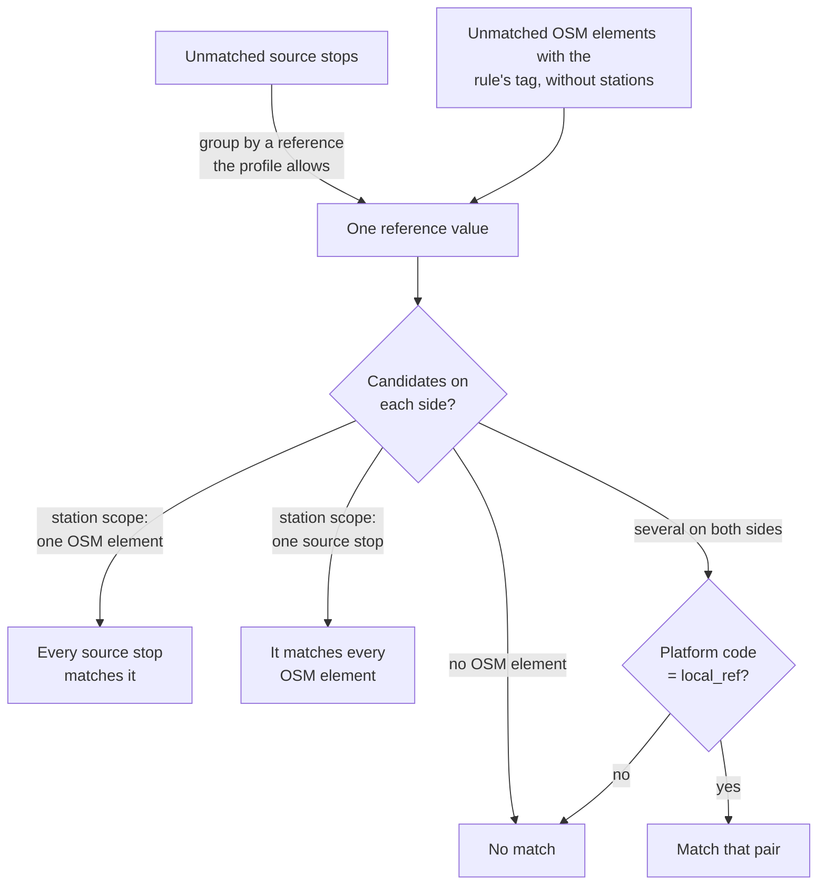

# E2.1 Exact matching

The exact rule (`exact`, rule 2 of [E2](2.%20Matching%20process.md#the-matching-rules)) matches stops that carry the same identifier in both datasets. It is the strongest evidence the engine uses, but only for identifiers that the [dataset profile](https://github.com/openTdataCH/stop_sync_osm_atlas/blob/main/documentation/0.1%20Glossary.md#dataset-profile) explicitly declares comparable: equal strings from different namespaces never count as the same stop. Feeds without such a declaration skip this rule and can still match by name, routes or distance.

In the Swiss profile, the identifier is the station's UIC number: ATLAS `number` against the OSM `uic_ref` tag.

| Dataset | Field | Record field | Example |
|---|---|---|---|
| ATLAS | `number` | `SourceStop.station_ref`, and a `uic` reference with scope `station` | `8503000` |
| OSM | `uic_ref` tag | `OsmNode.uic_ref` | `8503000` |

## How it works

For each `ReferenceRule` of the profile, the rule:

1. groups the unmatched source stops by the value of every reference the rule accepts (same reference namespace and scope, and the rule's source namespace if it sets one);
2. looks up the unmatched OSM elements whose rule tag (`uic_ref` for Switzerland) has that value, excluding stations and pair partners;
3. keeps the candidates that `ReferenceRule.accepts()` confirms, including any OSM scope tag the rule requires (for example a feed-specific `gtfs:feed` tag);
4. decides by the number of candidates on each side, as in the table below, and commits each pair with `match_type = exact`.

| Case | Station-scoped rule (Swiss UIC numbers) | Stop-scoped rule |
|---|---|---|
| One OSM element, several source stops | All source stops match the element | Ambiguous: an `ambiguous_exact_reference` diagnostic, no match |
| Several OSM elements, one source stop | The stop matches all elements | The only free candidate, or else the only one whose `local_ref` equals the platform code |
| Several on both sides | Each source stop takes the first free candidate whose `local_ref` equals its platform code, ignoring case | Ambiguous: an `ambiguous_exact_reference` diagnostic, no match |

Station scope deliberately allows one-to-many and many-to-one links: a station-level number cannot tell platforms apart on its own.

> [!IMPORTANT]
> The exact rule applies **no distance limit**. When only one OSM element carries a station's UIC number, every platform of that station is matched to it, however far away. "Exact" means the identifier matches, not the position: the real distance is stored with the match, and large distances surface as [distance problems](4.1%20Stop%20Problems.md#distance-problems).

## Platform codes

When several candidates exist on both sides, the platform code decides:

| Field | Record field | Means | Example |
|---|---|---|---|
| `designation` (ATLAS) | `SourceStop.platform_code` | The platform's label | `A`, `1`, `Nord` |
| `local_ref` (OSM) | `OsmNode.local_ref` | The platform's label; `ref` is used when `local_ref` is missing | `A`, `1` |
| `designationOfficial` (ATLAS) | `SourceStop.name` | The stop's name, not used by this rule | `Zürich HB` |

Source stops without a matching platform code stay unmatched for the later rules. Within a station-scoped group, an OSM element already taken by an earlier stop is skipped, so no element is matched twice by this rule.

## Code

`ExactReferencePredicate` in [core/predicates/exact_matching.py](../src/osm_public_transport_matcher/core/predicates/exact_matching.py) implements the rule; `ReferenceRule` and `MatchingProfile.allows_station_reference()` in [core/profile.py](../src/osm_public_transport_matcher/core/profile.py) define what is comparable.
