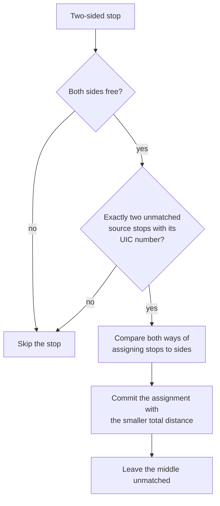
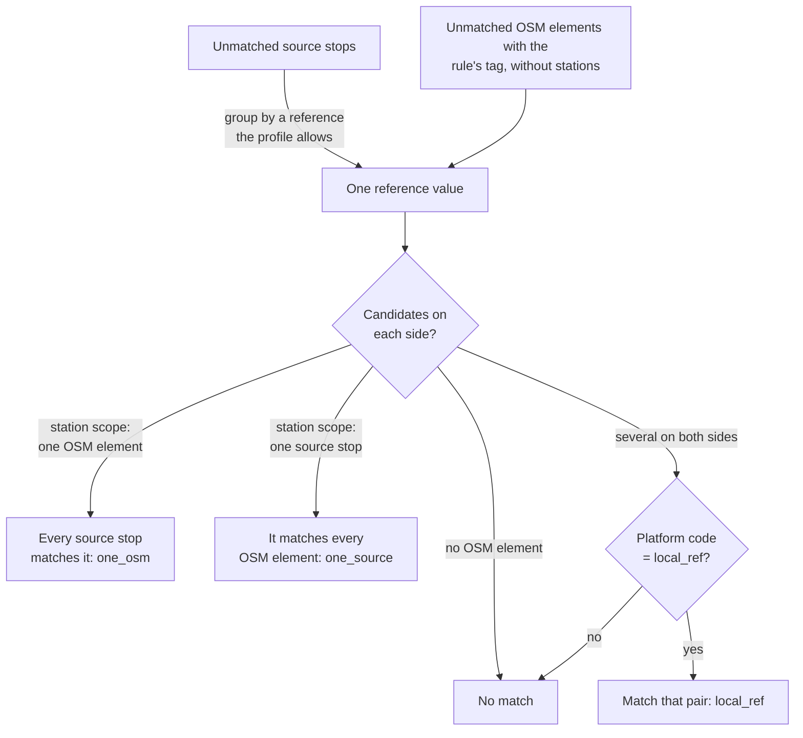

# E2.1 Reference matching

Reference matching links stops that carry the same identifier in both datasets. It is the strongest evidence the engine uses, but only for identifiers that the [dataset profile](https://github.com/openTdataCH/stop_sync_osm_atlas/blob/main/documentation/0.1%20Glossary.md#dataset-profile) explicitly declares comparable: equal strings from different namespaces never count as the same stop. Feeds without such a declaration skip these rules and can still match by name, routes or distance.

Two rules of [E2](2.%20Matching%20process.md#the-matching-rules) use references:

| # | Rule | Match types |
|---|---|---|
| 1 | `two_sided_stop` | `uic_two_sided_stop` |
| 2 | `reference` | `uic_reference_one_osm`, `uic_reference_one_source`, `uic_reference_local_ref` |

A match type starts with the namespace of the profile's reference rule. In the Swiss profile, the identifier is the station's UIC number, ATLAS `number` against the OSM `uic_ref` tag, so every match type starts with `uic_`.

| Dataset | Field | Record field | Example |
|---|---|---|---|
| ATLAS | `number` | `SourceStop.station_ref`, and a `uic` reference with scope `station` | `8503000` |
| OSM | `uic_ref` tag | `OsmNode.uic_ref` | `8503000` |

## Two-sided stops (`two_sided_stop`)

A PTv2 two-sided stop is one `public_transport=stop_position` with an element on each side, all three carrying the same UIC number ([OSM grouping](2.%20Matching%20process.md#osm-grouping-before-the-rules)). When exactly two ATLAS platforms carry that number, the UIC number alone cannot say which platform belongs to which side. This rule decides by distance.

For each two-sided stop, the rule takes the two side nodes and the unmatched source stops with the same UIC number. With exactly two such stops it evaluates both possible pairings, commits the one with the smaller total haversine distance as `uic_two_sided_stop`, and leaves the middle unmatched. The middle counts as [effectively matched](https://github.com/openTdataCH/stop_sync_osm_atlas/blob/main/documentation/0.1%20Glossary.md#effectively-matched) once both sides are matched. In any other situation the rule skips the stop and leaves it to the later rules.

The rule runs before `reference` because that rule sees the grouped stop as one element, its representative. With one OSM element for the UIC number, it would link both ATLAS platforms to that one side and leave the other side unmatched.

## How the reference rule works

For each `ReferenceRule` of the profile, the rule:

1. groups the unmatched source stops by the value of every reference the rule accepts (same reference namespace and scope, and the rule's source namespace if it sets one);
2. looks up the unmatched OSM elements whose rule tag (`uic_ref` for Switzerland) has that value, excluding stations and pair partners;
3. keeps the candidates that `ReferenceRule.accepts()` confirms, including any OSM scope tag the rule requires (for example a feed-specific `gtfs:feed` tag);
4. decides by the number of candidates on each side, as in the table below, and commits each pair with the match type of the branch that decided it.

| Case | Station-scoped rule (Swiss UIC numbers) | Stop-scoped rule |
|---|---|---|
| One OSM element, several source stops | All source stops match the element: `<namespace>_reference_one_osm` | Ambiguous: an `ambiguous_reference` diagnostic, no match |
| Several OSM elements, one source stop | The stop matches all elements: `<namespace>_reference_one_source` | The only free candidate (`<namespace>_reference_one_osm`), or else the only one whose `local_ref` equals the platform code (`<namespace>_reference_local_ref`) |
| Several on both sides | Each source stop takes the first free candidate whose `local_ref` equals its platform code, ignoring case: `<namespace>_reference_local_ref` | Ambiguous: an `ambiguous_reference` diagnostic, no match |

Station scope deliberately allows one-to-many and many-to-one links: a station-level number cannot tell platforms apart on its own. The match type keeps that visible: `uic_reference_one_osm` and `uic_reference_one_source` are station-level links, and only `uic_reference_local_ref` identifies a platform.

> [!IMPORTANT]
> The reference rule applies **no distance limit**. When only one OSM element carries a station's UIC number, every platform of that station is matched to it, however far away. The identifier matches, not necessarily the position: the real distance is stored with the match, and large distances surface as [distance problems](4.1%20Stop%20Problems.md#distance-problems).

## Platform codes

When several candidates exist on both sides, the platform code decides:

| Field | Record field | Means | Example |
|---|---|---|---|
| `designation` (ATLAS) | `SourceStop.platform_code` | The platform's label | `A`, `1`, `Nord` |
| `local_ref` (OSM) | `OsmNode.local_ref` | The platform's label; `ref` is used when `local_ref` is missing | `A`, `1` |
| `designationOfficial` (ATLAS) | `SourceStop.name` | The stop's name, not used by this rule | `Zürich HB` |

Source stops without a matching platform code stay unmatched for the later rules. Within a station-scoped group, an OSM element already taken by an earlier stop is skipped, so no element is matched twice by this rule.

## Code

| Element | Location |
|---|---|
| Reference rule | `ReferencePredicate` in [core/predicates/reference_matching.py](../src/osm_public_transport_matcher/core/predicates/reference_matching.py) |
| Two-sided stop rule | `TwoSidedStopPredicate` in [core/predicates/two_sided_stop_matching.py](../src/osm_public_transport_matcher/core/predicates/two_sided_stop_matching.py) |
| What is comparable | `ReferenceRule`, `MatchingProfile.allows_station_reference()` and `station_reference_namespace` in [core/profile.py](../src/osm_public_transport_matcher/core/profile.py) |
