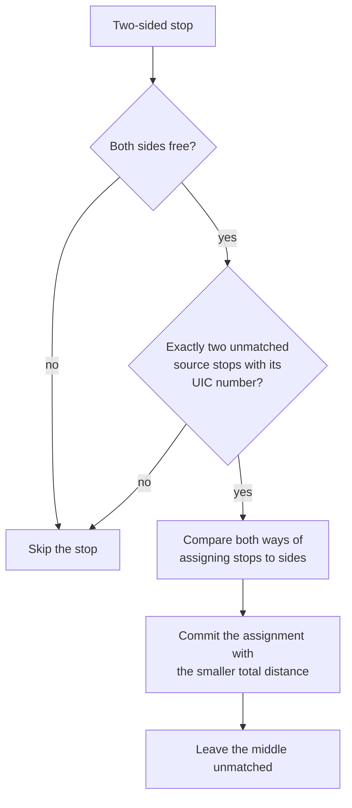
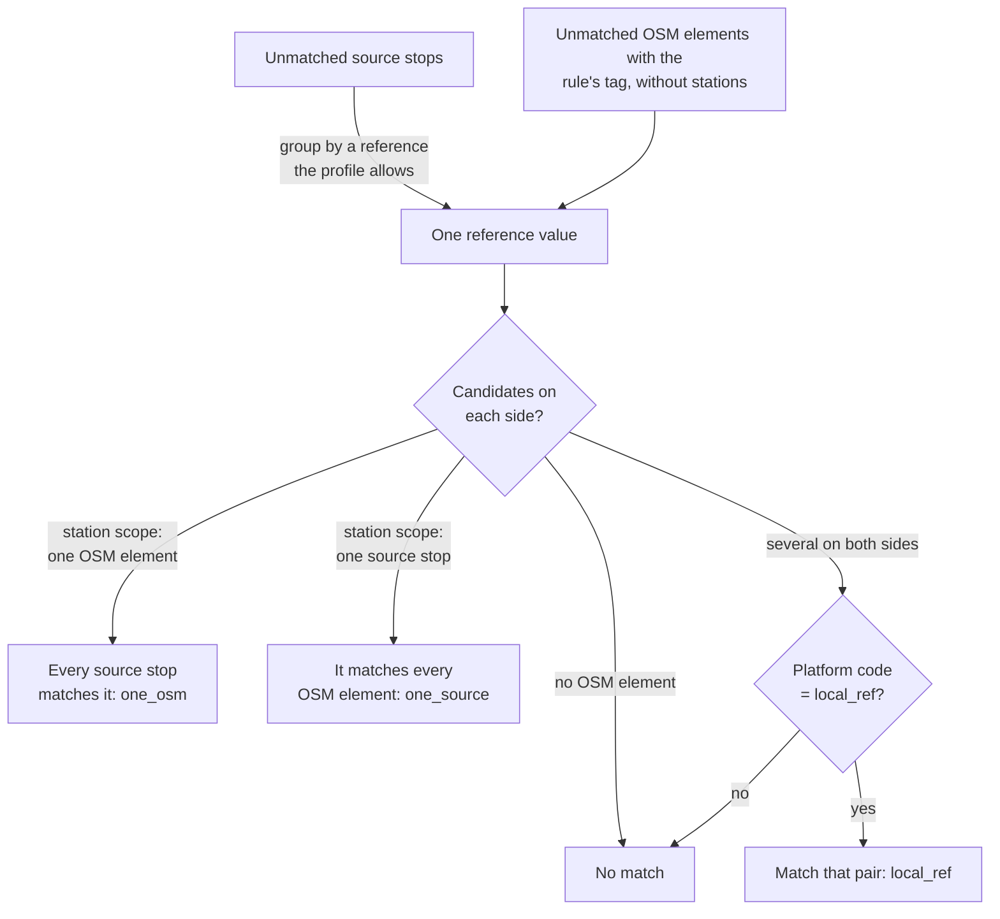

# E2.1 Reference matching

Reference matching links stops that carry the same identifier in both datasets. It is the strongest evidence the engine uses, but only for identifiers that the [dataset profile](https://github.com/openTdataCH/stop_sync_osm_atlas/blob/main/documentation/0.1%20Glossary.md#dataset-profile) explicitly declares comparable: equal strings from different namespaces never count as the same stop. Feeds without such a declaration skip these rules and can still match by name, routes or distance.

Three rules of [E2](2.%20Matching%20process.md#the-matching-rules) use identifiers:

| # | Rule | Match types |
|---|---|---|
| 1 | `identifier` | `sloid_identifier` |
| 2 | `two_sided_stop` | `uic_two_sided_stop` |
| 3 | `reference` | `uic_reference_one_osm`, `uic_reference_one_source`, `uic_reference_local_ref` |

A match type starts with the namespace of the profile's rule. In the Swiss profile, the identifier rule compares the SLOID of an ATLAS platform with the OSM tag `ref:sloid`, so its match type starts with `sloid_`; the reference rules compare the station's UIC number, ATLAS `number` against the OSM `uic_ref` tag, so theirs start with `uic_`.

## Identifier matching (`identifier`)

An OSM element can name the exact source stop it belongs to. Swiss mappers tag the SLOID of an ATLAS platform on its OSM elements: `ref:sloid=ch:1:sloid:7000:4:7`, or `railway:ref:sloid` on railway elements ([E1.3](1.3%20OSM%20data.md#stop-identifiers)). Such a value decides on its own, without distance, name or route evidence. The rule therefore runs first, so that no later rule gives a tagged element to another stop.

The profile declares the identifier with an `IdentifierRule`: the source reference namespace (`sloid`, which the ATLAS adapter gives every platform), the OSM keys, the form of a well-formed value and the separator of a list (`;`). For every unmatched OSM element except stations, the rule reads each value:

| Value | Example | Result |
|---|---|---|
| A source stop's identifier, within `long_distance` (150 m) of it | `ch:1:sloid:7000:4:7` | The element is linked to that stop: `sloid_identifier` |
| The same, farther away | | Not used; an [identifier problem](4.1%20Stop%20Problems.md#identifier-problems), P1 |
| A service point or an area that has stops | `ch:1:sloid:7000` | Not used: it names no single platform |
| Well formed, but no stop is or extends it | `ch:1:sloid:7000:9:99` | Not used; P2 |
| Malformed | `8503000` | Not used; P3 |

Every element that names a stop is linked to it: a platform node, its stop position, a second stop position for another mode. An element that lists several stops is linked to each, as a railway platform between two tracks. The stop is then matched, as with any rule. The rule also brings along:

- the element's PTv2 partner, from [OSM grouping](2.%20Matching%20process.md#osm-grouping-before-the-rules), as `osm_pair_propagation`, when the element names one platform (one stop, or the members of one source duplicate group) and the partner carries no identifier of its own;
- the stop's source duplicate group, as `source_duplicate_propagation`, except members that an element names themselves.

The 150 m limit catches tags copied from another stop. On the Swiss data, carriers lie a median 6 m from their platform and 99% within 65 m; the farthest were elements of another stop that kept the copied SLOID.

Ways that the adapter keeps only for their identifier, in practice platform areas, follow the same reading but run after all rules: each is linked to the stops it names as an extra element, never takes a stop away from another element and takes part in no other rule ([E2](2.%20Matching%20process.md#rules-shared-by-all-matching-rules)).

### Stations already touched by identifiers

Some later rules decide by elimination: when one OSM element carries a station's UIC number, the reference rule links every remaining platform of the station to it (`one_osm`), and the name rule links a stop to the only element left with its name (`name_one_osm`). Once identifiers have linked part of a station, its remaining elements are no longer the whole station, and that elimination would give the remaining platforms to whatever element is left, up to the other direction or the wrong side of the station. At a station where an identifier linked a stop or an element, the reference rule skips its `one_osm` and `one_source` branches and the name rule its `one_osm` branch. Platform codes still decide (`*_local_ref`), and the rest is left to the route and distance rules. `identified_stations()` in `core/predicates/identifier_matching.py` collects these stations.

| Dataset | Field | Record field | Example |
|---|---|---|---|
| ATLAS | `number` | `SourceStop.station_ref`, and a `uic` reference with scope `station` | `8503000` |
| OSM | `uic_ref` tag | `OsmNode.uic_ref` | `8503000` |

## Two-sided stops (`two_sided_stop`)

A PTv2 two-sided stop is one `public_transport=stop_position` with an element on each side, all three carrying the same UIC number ([OSM grouping](2.%20Matching%20process.md#osm-grouping-before-the-rules)). When exactly two ATLAS platforms carry that number, the UIC number alone cannot say which platform belongs to which side. This rule decides by distance.

For each two-sided stop, the rule takes the two side nodes and the unmatched source stops with the same UIC number. With exactly two such stops it evaluates both possible pairings, commits the one with the smaller total haversine distance as `uic_two_sided_stop`, and leaves the middle unmatched. The middle counts as [effectively matched](https://github.com/openTdataCH/stop_sync_osm_atlas/blob/main/documentation/0.1%20Glossary.md#effectively-matched) once both sides are matched. In any other situation the rule skips the stop and leaves it to the later rules.

The rule runs before `reference` because that rule sees the grouped stop as one element, its representative. With one OSM element for the UIC number, it would link both ATLAS platforms to that one side and leave the other side unmatched.

## How the reference rule works

For each `ReferenceRule` of the profile, the rule:

1. groups the unmatched source stops by the value of every reference the rule accepts (same reference namespace and scope, and the rule's source namespace if it sets one);
2. looks up the unmatched OSM elements whose rule tag (`uic_ref` for Switzerland) has that value, excluding stations and pair partners;
3. keeps the candidates that `ReferenceRule.accepts()` confirms, including any OSM scope tag the rule requires (for example a feed-specific `gtfs:feed` tag);
4. decides by the number of candidates on each side, as in the table below, and commits each pair with the match type of the branch that decided it.

| Case | Station-scoped rule (Swiss UIC numbers) | Stop-scoped rule |
|---|---|---|
| One OSM element, several source stops | All source stops match the element: `<namespace>_reference_one_osm` | Ambiguous: an `ambiguous_reference` diagnostic, no match |
| Several OSM elements, one source stop | The stop matches all elements: `<namespace>_reference_one_source` | The only free candidate (`<namespace>_reference_one_osm`), or else the only one whose `local_ref` equals the platform code (`<namespace>_reference_local_ref`) |
| Several on both sides | Each source stop takes the first free candidate whose `local_ref` equals its platform code, ignoring case: `<namespace>_reference_local_ref` | Ambiguous: an `ambiguous_reference` diagnostic, no match |

Station scope deliberately allows one-to-many and many-to-one links: a station-level number cannot tell platforms apart on its own. The match type keeps that visible: `uic_reference_one_osm` and `uic_reference_one_source` are station-level links, and only `uic_reference_local_ref` identifies a platform.

> [!IMPORTANT]
> The reference rule applies **no distance limit**. When only one OSM element carries a station's UIC number, every platform of that station is matched to it, however far away. The identifier matches, not necessarily the position: the real distance is stored with the match, and large distances surface as [distance problems](4.1%20Stop%20Problems.md#distance-problems).

## Platform codes

When several candidates exist on both sides, the platform code decides:

| Field | Record field | Means | Example |
|---|---|---|---|
| `designation` (ATLAS) | `SourceStop.platform_code` | The platform's label | `A`, `1`, `Nord` |
| `local_ref` (OSM) | `OsmNode.local_ref` | The platform's label; `ref` is used when `local_ref` is missing | `A`, `1` |
| `designationOfficial` (ATLAS) | `SourceStop.name` | The stop's name, not used by this rule | `Zürich HB` |

Source stops without a matching platform code stay unmatched for the later rules. Within a station-scoped group, an OSM element already taken by an earlier stop is skipped, so a platform code never gives one element to two stops.

## Code

| Element | Location |
|---|---|
| Identifier rule | `IdentifierPredicate` in [core/predicates/identifier_matching.py](../src/osm_public_transport_matcher/core/predicates/identifier_matching.py); the reading of values in `IdentifierIndex`, [core/identifiers.py](../src/osm_public_transport_matcher/core/identifiers.py) |
| Reference rule | `ReferencePredicate` in [core/predicates/reference_matching.py](../src/osm_public_transport_matcher/core/predicates/reference_matching.py) |
| Two-sided stop rule | `TwoSidedStopPredicate` in [core/predicates/two_sided_stop_matching.py](../src/osm_public_transport_matcher/core/predicates/two_sided_stop_matching.py) |
| What is comparable | `IdentifierRule`, `ReferenceRule`, `MatchingProfile.allows_station_reference()` and `station_reference_namespace` in [core/profile.py](../src/osm_public_transport_matcher/core/profile.py) |
