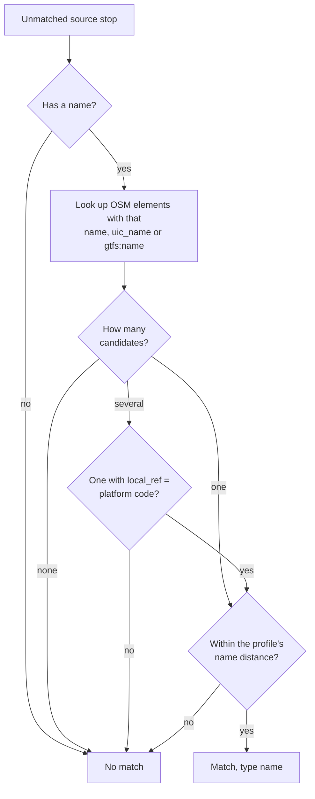

# E2.2 Name matching

The name rule (`name`, rule 3 of [E2](2.%20Matching%20process.md#the-matching-rules)) matches a source stop to an OSM element with exactly the same name. It catches stops that the [exact rule](2.1%20Exact%20matching.md) could not match, for example because the OSM element has no `uic_ref`.

## How it works

For each unmatched source stop with a non-empty name, the rule looks up the OSM elements whose `name`, `uic_name` or `gtfs:name` tag is **exactly** that string: case, accents and abbreviations must agree. Stations and pair partners are excluded, as for every rule.

- **One candidate:** it is chosen.
- **Several candidates:** the first whose `local_ref` equals the stop's platform code, ignoring case, is chosen. Without such a candidate, or when the stop has no platform code, the stop stays unmatched.
- **Distance limit:** the chosen candidate must lie within the profile's `name_match_max_distance`: 1000 m in the default profile, because the same name can occur in several towns. The Swiss profile sets no limit.

| Dataset | Name field | Record field | Platform code |
|---|---|---|---|
| ATLAS | `designationOfficial` | `SourceStop.name` | `SourceStop.platform_code` (`designation`) |
| OSM | `name`, `uic_name`, `gtfs:name` tags | `OsmNode.name`, `OsmNode.uic_name`, `tags['gtfs:name']` | `OsmNode.local_ref` |

Stops still unmatched go on to the [route rule](2.3%20Stop-stop%20matching%20using%20routes.md) and the [distance rules](2.4%20Distance%20matching.md).

## Name aliases in the Swiss profile

The OSM name index lists an element under each of its name tags. The Swiss profile sets `preserve_name_alias_multiplicity`, which keeps an element listed once **per tag**, even when `name` and `uic_name` hold the same value. Such an element then counts as two candidates for that name, so the name rule can only choose it through a matching platform code; otherwise a later rule matches it, typically the group rule as `distance_matching_1_uic_name`. The generic profile lists each distinct name once. The Swiss setting preserves the decisions of the original pipeline, which the regression fixture `examples/swiss/expected.json` records.

## Why the rule matches few stops

- The exact rule runs first and already matches most stops whose UIC number appears in OSM.
- Names differ in small ways between the datasets, for example *St.* and *Sankt*, or a municipality prefix. The rule does not normalize names.

## Code

`NameMatchPredicate` in [core/predicates/name_matching.py](../src/osm_public_transport_matcher/core/predicates/name_matching.py); the name index is built by `OsmState.from_records()` in [core/state.py](../src/osm_public_transport_matcher/core/state.py).
