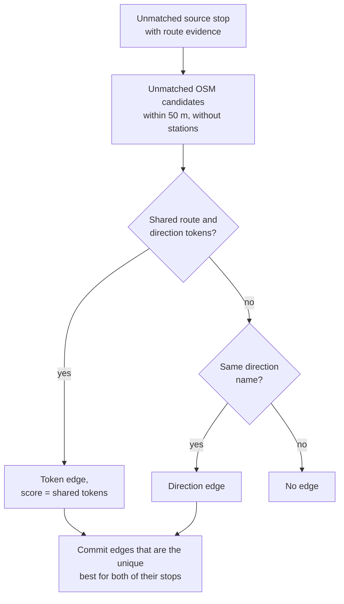

# E2.3 Route matching

The route rule (`route`, rule 4 of [E2](2.%20Matching%20process.md#the-matching-rules)) matches a source stop to a nearby OSM element when both are served by the same route in the same direction. It runs before the purely distance-based rules, so that route evidence can separate stops that are close together, for example the two platforms on opposite sides of a road.

This is still stop-to-stop matching: routes are evidence that two nearby points are the same stop. Comparing whole routes is a separate step, described in [E3.2 Route-route matching](3.2%20Route-Route%20Matching.md).

## The evidence

The rule reads route evidence that the adapters prepared; it performs no file access.

| Side | Evidence | Source |
|---|---|---|
| Source stop | Its routes with direction: `(route_id, direction_id)` and the normalized `(route_id_normalized, direction_id)`; also each itinerary's direction label, such as `Zürich HB → Bern` | GTFS itineraries, through `ctx.source.get_route_evidence(key)` |
| OSM element | The OSM route relations it belongs to: `(gtfs:route_id, direction)` and its normalized form, plus the source route that `RouteState` maps the relation to | OSM XML, through `ctx.osm.get_node_routes(node_id)` |
| OSM element | The direction names of those relations: the name of the first member, an arrow and the name of the last member | `ctx.osm.name_dirs` |

OSM directions come from the relation's `ref_trips` tag: a trip id ending in `.H` means direction `0`, `.R` means `1`. A relation without either suffix contributes tokens for both directions, so that the route identifier alone can still match.

Route identifiers are scoped and normalized by the adapters: the Swiss adapter replaces the timetable-year code (`-j25`) with `-jXX`, so an OSM tag entered in an earlier year still matches; a generic GTFS adapter prefixes identifiers with its feed namespace. When either side has no route evidence at all, the engine records a `route_evidence_unavailable` diagnostic and the rule matches nothing.

## How the rule decides

Instead of deciding stop by stop, the rule first collects every candidate pair, then commits only unambiguous ones:

1. **Collect edges.** For every unmatched source stop with route evidence, look at each unmatched, non-station OSM element within 50 m (`max_distance`). If they share route tokens, add a *token edge* whose score is the number of shared tokens. Otherwise, if they share a direction name, add a *direction edge*.
2. **Keep mutual best token edges.** An edge is kept when it is the single best-scoring edge of its source stop *and* of its OSM element. A tie for the best score keeps neither.
3. **Commit** the kept edges as `route_gtfs_tokens`, strongest first.
4. **Repeat with direction edges** for the stops and elements still free, committing them as `route_gtfs_direction`.

Everything else stays unmatched for the [distance rules](2.4%20Distance%20matching.md). Requiring the best choice from both sides prevents a greedy outcome in which the first stop processed takes an element that another stop has stronger evidence for.

## When the rule helps

- An OSM platform has no `uic_ref`, but its route relations tie it to the official stop.
- Several OSM elements are equally close; only one serves the stop's routes.
- Two platforms of one station face opposite directions; the route direction picks the right side before distance alone could choose the wrong one.

The same evidence is checked again after matching: a match whose routes contradict each other becomes a [`contradicts_route_matching` problem](4.1%20Stop%20Problems.md#contradicts-route-matching-problems).

## Code

| Element | Location |
|---|---|
| The rule | `RouteMatchPredicate` in [core/predicates/route_matching_gtfs.py](../src/public_transport_matcher/core/predicates/route_matching_gtfs.py) |
| Token construction and contradiction check | [core/utils/route_matching.py](../src/public_transport_matcher/core/utils/route_matching.py) |
| Relation-to-route mapping | `RouteState` in [core/route_state.py](../src/public_transport_matcher/core/route_state.py) |
| OSM evidence parsing | `read_osm()` in [adapters/osm.py](../src/public_transport_matcher/adapters/osm.py) |

## Related pages

- [E1.2 GTFS and ATLAS](1.2%20GTFS%20ATLAS%20data.md): how GTFS itineraries are built
- [E1.3 OSM data](1.3%20OSM%20data.md): how route relations are read
- [E3.2 Route-route matching](3.2%20Route-Route%20Matching.md): matching whole routes
