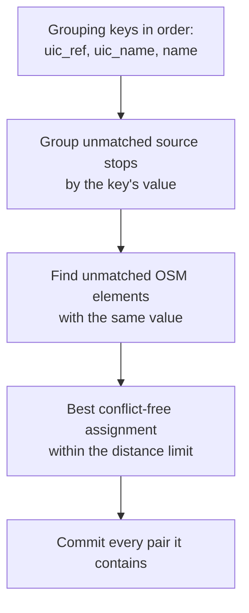
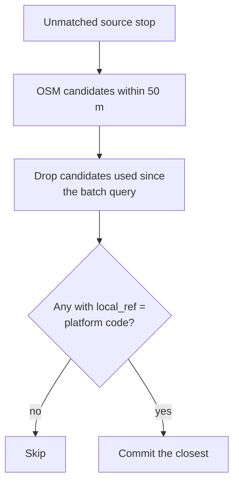
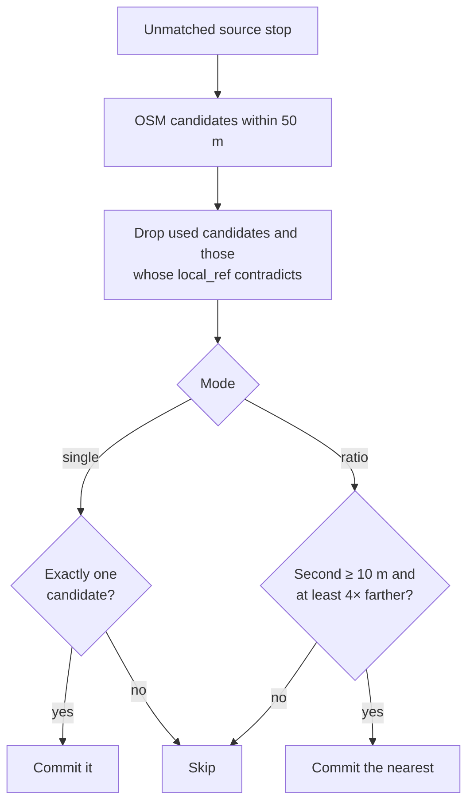

# E2.4 Distance matching

The distance rules match stops by position. They are the last six of the eleven rule executions in [E2](2.%20Matching%20process.md#the-matching-rules): they run after the reference, name and GTFS route rules and become progressively looser. All values below are the defaults, shared by the generic and Swiss profiles; a profile can change them.

| # | Rule | Class | Match type |
|---|---|---|---|
| 6 | `group_distance` | `GroupDistancePredicate` | `<key>_group_distance` |
| 7 | `group_long_distance` | `GroupDistancePredicate`, 150 m | `<key>_group_long_distance` |
| 8 | `local_ref_distance` | `LocalRefDistancePredicate` | `local_ref_distance` |
| 9 | `distance_only_candidate` | `NearestDistancePredicate`, single mode | `distance_only_candidate` |
| 10 | `distance_ratio` | `NearestDistancePredicate`, ratio mode | `distance_ratio` |
| 11 | `distance_only_candidate_second_pass` | `NearestDistancePredicate`, second single pass | `distance_only_candidate_second_pass` |

`<key>` is the grouping key: `uic_ref`, `uic_name` or `name`. The `quality_metrics` extension of each bundle reports distance statistics per match type. The rules run one after another, never in parallel, and each sees the state left by the previous one. The [two-sided stop rule](2.1%20Reference%20matching.md#two-sided-stops-two_sided_stop) also compares distances, but it only assigns platforms within one UIC number, so it belongs to reference matching.

## Group distance rules (`group_distance` and `group_long_distance`)



The group rules match whole groups at once. For each grouping key, in order:

1. **`uic_ref`:** source stops whose station reference the profile allows, against OSM elements with the same `uic_ref` (only when the profile enables station references);
2. **`uic_name`:** source stop names against OSM `uic_name`;
3. **`name`:** source stop names against OSM `name`,

the rule groups the unmatched source stops by the key's value and finds the unmatched, non-station OSM elements with that value. Within each group it chooses a one-to-one assignment that:

1. matches as many pairs as possible within the distance limit, and
2. among those, has the smallest total distance.

Outliers do not block a group: stops without a valid partner simply stay unmatched. The assignment is solved exactly with `scipy.optimize.linear_sum_assignment` on the full distance matrix of the group, padded with "stay unmatched" options (`bipartite_match_max_cardinality()`).

The first execution, `group_distance`, allows 50 m (`max_distance`). The second execution, `group_long_distance`, repeats the same procedure with 150 m (`long_distance`) for what the first left unmatched. A representative is listed under its pair partner's tag values too, so a pair stays findable when only one member carries the UIC number or name.

## local_ref distance rule (`local_ref_distance`)



A source stop with a platform code is matched to the closest OSM element within 50 m whose `local_ref` equals that code, ignoring case.

## Nearest-candidate rules



The same rule runs three times:

1. **Only candidate (`distance_only_candidate`):** exactly one candidate within 50 m.
2. **Ratio test (`distance_ratio`):** with several candidates, the nearest wins when the second is at least 10 m away (`ratio_min_second_distance`) and at least 4 times as far (`ratio_factor`).
3. **Only candidate again (`distance_only_candidate_second_pass`):** catches stops that became unambiguous because rule 10 took a competing candidate.

With d₁ the distance to the nearest candidate and d₂ the distance to the second: **match the nearest when d₂ ≥ 10 m and d₂ / d₁ ≥ 4.**

| Candidate | Distance | Result |
|---|---|---|
| OSM A | d₁ = 5 m | Matched: d₂ / d₁ = 25 / 5 = 5 ≥ 4 |
| OSM B | d₂ = 25 m | — |
| OSM C | 40 m | — |

Before counting candidates, both modes remove every OSM element whose `local_ref` contradicts the stop's platform code. When either value is empty, nothing is contradicted.

## Revalidating batch candidates

The `local_ref` distance and nearest rules query the spatial index once for all unmatched stops, then process the stops one by one. Because every commit locks its OSM element immediately, each stop re-checks its candidate list against the live state first. Without that check, a later stop could treat an element taken a moment earlier as its only candidate.

## Spatial index

The `local_ref` distance, nearest and GTFS route rules use a KDTree over 3D unit-sphere coordinates. `OsmState.batch_query_radius()` calls `query_ball_point(points, workers=-1)` once for all stops, then computes exact haversine distances for the returned candidates:

```python
coords = [(stop.lat, stop.lon) for stop in unmatched]
candidates = ctx.osm.batch_query_radius(coords, ctx.max_distance)
```

The tree is built once from the elements that pass the station filter; used elements and pair partners are filtered at query time. The group rules compute their distance matrices with NumPy instead, and the two-sided stop rule computes its four distances directly.

## What distance matching does not do

- An OSM element is never matched twice by a distance rule. Several distinct elements, such as a platform and a stop position, can still match different stops.
- Isolation is detected after all rules: an unmatched stop with no element of the other side within the isolation radius (50 m) is marked isolated. This creates no match; it feeds [problem detection](4.%20Problems.md).

## Code

| Element | Location |
|---|---|
| Group, `local_ref` distance and nearest rules; `bipartite_match_max_cardinality()` | [core/predicates/distance_matching.py](../src/osm_public_transport_matcher/core/predicates/distance_matching.py) |
| Spatial index and batch queries | [core/utils/spatial_index.py](../src/osm_public_transport_matcher/core/utils/spatial_index.py), [core/state.py](../src/osm_public_transport_matcher/core/state.py) |
