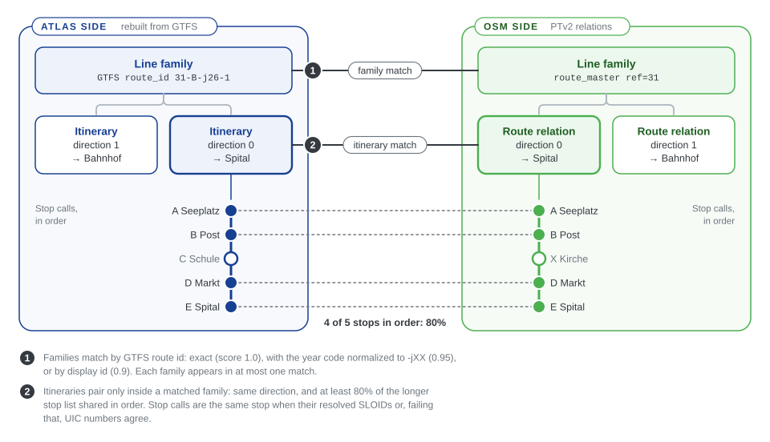

# E3 Routes

Besides stops, the engine compares whole public transport lines: which lines exist on both sides, and whether their directions serve the same stops in the same order. This chapter explains the route model and how the comparison works. Route evidence is also used earlier, as one of the stop-matching rules ([E2.3](2.3%20Stop-stop%20matching%20using%20routes.md)); this chapter is about comparing the routes themselves.

Both sides are brought into the same three levels, so they can be compared level by level:

| Level | Source side (rebuilt from GTFS) | OSM side (PTv2) |
|---|---|---|
| **Line family**: one line | A GTFS `route_id` | A `route_master`, else a shared `gtfs:route_id`, else a synthetic key, else the relation itself |
| **Itinerary**: one direction or variant | A bucket of trips with the same direction and headsign | One `type=route` relation |
| **Stop call**: one stop, in order | A stop of the bucket's most frequent pattern | A stop member of the relation |

Families are matched first (1 in the figure), by GTFS route identifier. Itineraries are then paired only inside a matched family (2): their directions must agree and enough of their stops must coincide in order. The example pairs two itineraries that share four of five stops, exactly the 80% minimum.

## The three stages

1. **Adapters** produce source-specific route products: the Swiss products rebuilt from GTFS ([E1.2](1.2%20GTFS%20ATLAS%20data.md)) and the OSM route products built from the current XML ([E1.3](1.3%20OSM%20data.md)).
2. **Normalization:** after stop matching, `osm_public_transport_matcher.routes.compare_routes()` converts both into shared `line_families`, `itineraries` and `stop_calls`, resolving each OSM stop call to a source stop where possible.
3. **Matching:** it builds `line_family_matches` and `itinerary_matches` and returns them, with the products, for the bundle's `routes` section.

The comparison reads no files: `routes.py` receives DataFrames from the adapters and returns a complete payload. In the Swiss runner, the source products may come from verified cache files, while the OSM products are always rebuilt from the run's own XML. The review application imports the results; it never compares sequences or chooses links itself.

Route products appear in two places, for two different jobs:

| Consumer | Uses | Purpose |
|---|---|---|
| Stop matching | Route memberships per stop, through `SourceState`, `OsmState` and `RouteState` | Evidence that two nearby stops are the same ([E2.3](2.3%20Stop-stop%20matching%20using%20routes.md)) |
| Route comparison | Complete families, itineraries and stop calls, in `routes.py` | Which lines and directions correspond ([E3.2](3.2%20Route-Route%20Matching.md)) |

## One set of source products

Every source adapter delivers the same three products: `source_routes`, `source_itineraries` and `source_stop_calls`. The generic GTFS adapter keys them by feed namespace and keeps ordered calls and repeated visits of the same stop; the Swiss integration resolves each stop call to its ATLAS platform. Dataset-specific rules stay in the adapters: the Swiss route-year normalization, for example, is applied by the Swiss adapter, not by `routes.py`.

Route-level problems, such as an unmatched line or a sequence mismatch, are planned but not detected yet; see [E4.2](4.2%20Route%20Entity%20Problems.md) and [E4.3](4.3%20Route%20Membership%20Problems.md).

## Pages in this section

- [E3.1 Route data flow](3.1%20Route%20Pipeline%20Data%20Flow.md): the tables at each stage
- [E3.2 Route-route matching](3.2%20Route-Route%20Matching.md): how families and itineraries are paired

## Related pages

- [E1.2 GTFS and ATLAS](1.2%20GTFS%20ATLAS%20data.md) and [E1.3 OSM data](1.3%20OSM%20data.md): the route inputs
- [A1.1 Bundle import and publication](https://github.com/openTdataCH/stop_sync_osm_atlas/blob/main/documentation/1.1%20Import%20Process.md) and [A2.6 Routes pages](https://github.com/openTdataCH/stop_sync_osm_atlas/blob/main/documentation/2.6%20Routes%20Pages.md): how the review application stores and shows routes
