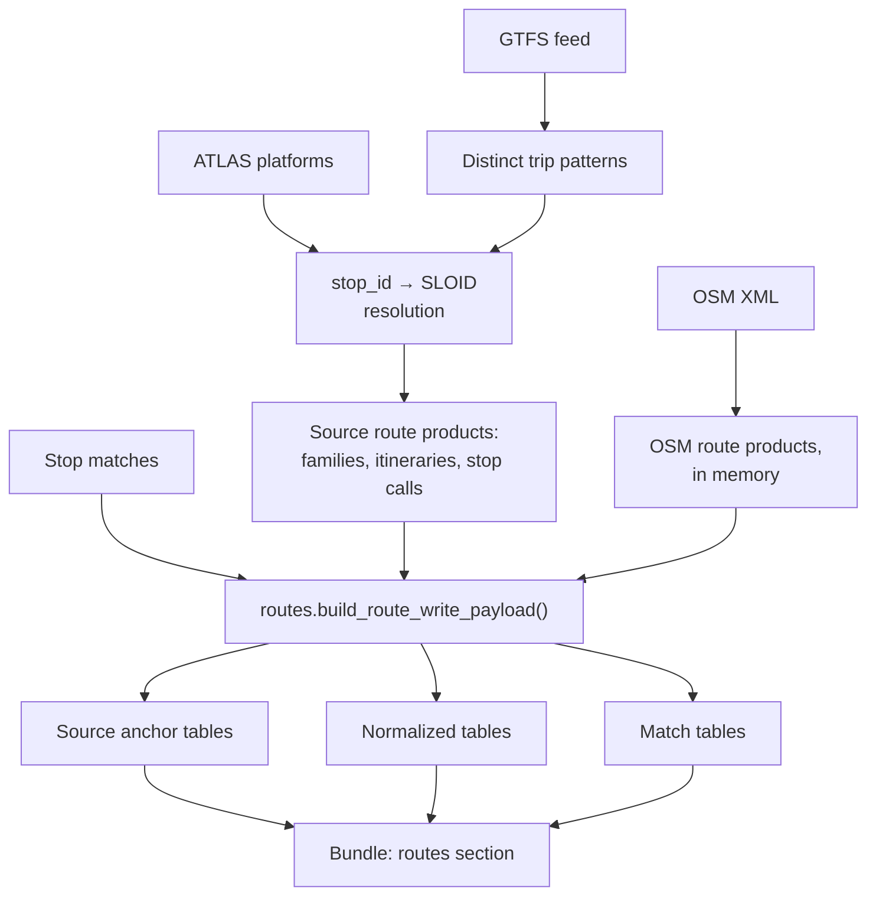

# E3.1 Route data flow

This page follows route data from the input files to the tables in the result bundle: what each stage produces and which module produces it. [E3](3.%20Routes.md) explains the model; [E3.2](3.2%20Route-Route%20Matching.md) the matching rules.

## Source products

The two sides start from different structures.

**Source side.** ATLAS has no line or itinerary records, so the Swiss integration rebuilds them from GTFS ([E1.2](1.2%20GTFS%20ATLAS%20data.md)):

| GTFS file | Role |
|---|---|
| `stops.txt` | Stop identifiers, names and positions |
| `stop_times.txt` | The ordered stops of each trip |
| `trips.txt` | Each trip's route, direction and headsign |
| `routes.txt` | Line metadata: short and long name, mode |

Each GTFS `route_id` becomes a family; trips are grouped into itineraries; each itinerary keeps one representative stop sequence; each stop call keeps its resolved SLOID when one exists. The products are `atlas_line_families`, `atlas_itineraries` and `atlas_itinerary_stop_calls`.

**OSM side.** OSM's PTv2 scheme already has the structure: stop elements, `type=route` relations (the itineraries) and optional `type=route_master` relations above them (the families). The OSM adapter keeps it in seven frames: `osm_route_masters`, `osm_route_master_tags`, `osm_route_master_members`, `osm_route_relations`, `osm_route_relation_tags`, `osm_route_relation_members` and `osm_route_relation_stops` ([E1.3](1.3%20OSM%20data.md#route-products)).

## Normalized tables

`src/transport_matcher/routes.py` converts both sides into one model:

| Table | One row per | Built from |
|---|---|---|
| `line_families` | family on either side | Source: one per `atlas_line_id`. OSM: the route master, else the normalized `gtfs:route_id`, else a synthetic key from `route`, `ref`, `operator` and `network`, else the relation itself |
| `itineraries` | itinerary on either side | Source: `atlas_itineraries`. OSM: one per route relation. Both carry a direction, a display label and a stop count when known |
| `stop_calls` | stop of an itinerary, in order | Source: GTFS stop, resolved SLOID, platform code and label. OSM: member node, role, canonical key and label |

For OSM stop calls, the engine looks for the shared stop identity in this order: the SLOID of the source stop that the node was matched to; else the single SLOID that has the call's `uic_ref`; else the raw key `uic:<uic_ref>` or `osm:<node_id>`. That resolution is what lets the two sides be compared stop by stop.

The source anchor tables `atlas_line_families` and `osm_route_relations` travel in the bundle as well, as the raw records behind the normalized rows.

## Match tables

| Table | Links |
|---|---|
| `line_family_matches` | One source family to one OSM family |
| `itinerary_matches` | One source itinerary to one OSM itinerary inside an already matched family, with its scores |

## Code

| Module | Role |
|---|---|
| `src/transport_matcher/adapters/gtfs_columnar.py` | Reduces the national feed to trip patterns |
| `src/transport_matcher/adapters/get_atlas_gtfs.py` | Resolves GTFS identities and builds the source route frames |
| `src/transport_matcher/adapters/get_atlas_data.py` | ATLAS selection and the itinerary frames of the cache |
| `src/transport_matcher/adapters/acquisition.py` | The separately cached ATLAS, GTFS and mapping stages |
| `src/transport_matcher/adapters/osm_routes.py` | The OSM route frames, and optional diagnostic CSV files |
| `src/transport_matcher/routes.py` | Normalization and matching, without file access |

The review application stores these tables when it imports a bundle; see [A1 Database](https://github.com/openTdataCH/stop_sync_osm_atlas/blob/main/documentation/1.%20Database.md). [E5.2](5.2%20Pipeline%20Performance.md) covers the candidate indexes and the score-only sequence alignment that keep route comparison fast.
