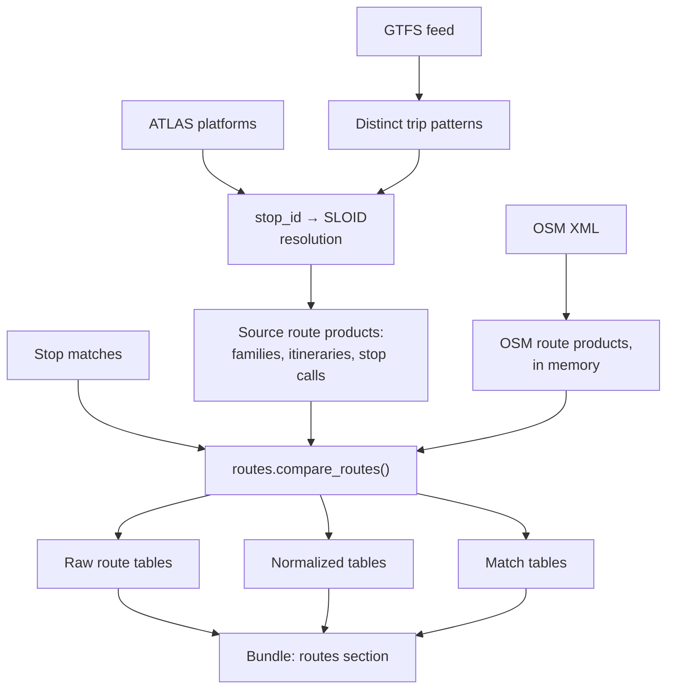

# E3.1 Route data flow

This page follows route data from the input files to the tables in the result bundle: what each stage produces and which module produces it. [E3](3.%20Routes.md) explains the model; [E3.2](3.2%20Route-route%20matching.md) the matching rules.

## Source products

The two sides start from different structures.

**Source side.** Every adapter delivers routes, itineraries and ordered stop calls built from a GTFS feed. ATLAS itself has no line or itinerary records, so the Swiss integration rebuilds them from the Swiss GTFS ([E1.2](1.2%20Swiss%20GTFS%20and%20ATLAS.md)); the generic adapter reads any feed ([E1](1.%20Input%20integrations%20%26%20acquisition.md#any-other-gtfs-feed)):

| GTFS file | Role |
|---|---|
| `stops.txt` | Stop identifiers, names and positions |
| `stop_times.txt` | The ordered stops of each trip |
| `trips.txt` | Each trip's route, direction and headsign |
| `routes.txt` | Line metadata: short and long name, mode |

Each GTFS `route_id` becomes a route; trips are grouped into itineraries; each itinerary keeps one representative stop sequence; each stop call keeps its resolved source stop key when one exists. The products are `source_routes`, `source_itineraries` and `source_stop_calls`.

**OSM side.** OSM's PTv2 scheme already has the structure: stop elements, `type=route` relations (the itineraries) and optional `type=route_master` relations above them (the families). The OSM adapter keeps it in seven frames: `osm_route_masters`, `osm_route_master_tags`, `osm_route_master_members`, `osm_route_relations`, `osm_route_relation_tags`, `osm_route_relation_members` and `osm_route_relation_stops` ([E1.3](1.3%20OSM%20input%20and%20acquisition.md#route-products)).

## Normalized tables

`src/osm_public_transport_matcher/routes.py` converts both sides into one model:

| Table | Source side | OSM side |
|---|---|---|
| `line_families` | One per `route_id` | One per group of route relations ([grouping order](3.2%20Route-route%20matching.md#step-1-build-the-families)) |
| `itineraries` | One per `source_itineraries` row | One per route relation |
| `stop_calls` | The `source_stop_calls` of the itinerary | The stop members of the relation, one call per stop visit |

Each OSM stop call is resolved to a source stop where possible, which lets the two sides be compared stop by stop; [E3.2](3.2%20Route-route%20matching.md#step-3-build-itineraries-and-stop-calls) gives the order in which the identity is looked up.

The raw route tables `source_routes` and `osm_route_relations` travel in the bundle as well, as the records behind the normalized rows. The bundle's [`routes` section](Result%20bundle%20format.md#routes) lists the fields of every table.

## Match tables

Matching adds `line_family_matches`, which links one source family to one OSM family, and `itinerary_matches`, which links one source itinerary to one OSM itinerary of a matched family, with its scores ([E3.2](3.2%20Route-route%20matching.md)).

## Code

| Module | Role |
|---|---|
| `src/osm_public_transport_matcher/adapters/gtfs_columnar.py` | Reduces the national feed to trip patterns |
| `src/osm_public_transport_matcher/adapters/gtfs.py` | The source products of any GTFS feed |
| `src/osm_public_transport_matcher/adapters/get_atlas_gtfs.py` | Resolves Swiss GTFS stops to ATLAS SLOIDs |
| `src/osm_public_transport_matcher/adapters/get_atlas_data.py` | ATLAS selection and the Swiss source route products |
| `src/osm_public_transport_matcher/adapters/acquisition.py` | The separately cached ATLAS, GTFS and mapping stages |
| `src/osm_public_transport_matcher/adapters/osm_routes.py` | The OSM route frames, and optional diagnostic CSV files |
| `src/osm_public_transport_matcher/routes.py` | Normalization and matching, without file access |

The review application stores these tables when it imports a bundle; see [A1 Database](https://github.com/openTdataCH/stop_sync_osm_atlas/blob/main/documentation/1.%20Database%20%26%20bundle%20import.md). [E5.2](5.2%20Pipeline%20performance.md) covers the candidate indexes and the score-only sequence alignment that keep route comparison fast.

## Related pages

- [E3.2 Route-route matching](3.2%20Route-route%20matching.md): the rules that fill the match tables
- [E1.2 GTFS and ATLAS](1.2%20Swiss%20GTFS%20and%20ATLAS.md#outputs) and [E1.3 OSM data](1.3%20OSM%20input%20and%20acquisition.md#route-products): the source and OSM route products
- [Result bundle format](Result%20bundle%20format.md#routes): how the tables are written
- [A1 Database & bundle import](https://github.com/openTdataCH/stop_sync_osm_atlas/blob/main/documentation/1.%20Database%20%26%20bundle%20import.md): where the review application stores them
