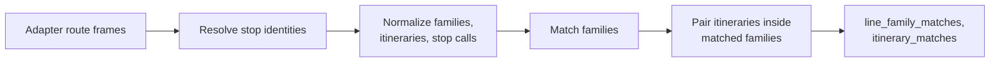

# E3.2 Route-route matching

This page explains how the engine pairs whole lines and their directions after stop matching: first line families, then itineraries inside each matched family. It is route-level matching; matching a stop to a stop with route evidence is a different rule, described in [E2.3](2.3%20Stop-stop%20matching%20using%20routes.md).

Two route computations exist, both in the engine. Before stop matching, a per-run `RouteState` maps OSM relations to source routes as evidence for the route rule. After stop matching, `build_route_write_payload()` compares complete families and ordered itineraries using the matched stop identities; this page describes the second.

## Inputs

The comparison receives DataFrames from the adapters. The names are logical product names; the Swiss source products may come from same-named cache files, while the OSM products normally exist only in memory:

- `atlas_line_families`, `atlas_itineraries`, `atlas_itinerary_stop_calls`
- `osm_route_masters`, `osm_route_relations`, `osm_route_relation_members`, `osm_route_relation_stops`
- the stop-matching output, so that OSM stop calls can reuse the source identity their node was matched to

## Step 1: build the families

- **Source:** one family per `atlas_line_id`, with the normalized route identifier and the GTFS display fields (`route_short_name`, `route_long_name`).
- **OSM:** relations are grouped into families by the first available of: the parent `route_master`; the normalized `gtfs:route_id`; a synthetic key from `route`, `ref`, `operator` and `network`; the relation itself. Every relation therefore belongs to some family, even without a route master or GTFS tag.

## Step 2: match the families

Each candidate pair of a source family and an OSM family gets a score:

| Score | `match_method` | When |
|---|---|---|
| 1.0 | `exact_gtfs_route_id` | The OSM `gtfs:route_id` equals the source route identifier |
| 0.95 | `normalized_gtfs_route_id` | The identifiers are equal after year normalization (`-jXX`) |
| 0.9 | `display_route_id_match` | The OSM family's display identifier equals the source route identifier |

OSM families marked `is_non_gtfs` are skipped. Pairs are then chosen greedily from the highest score down, ties broken by identifier, and each family can appear in at most one `line_family_matches` row. Only candidates reachable through these three identifier indexes are scored, which gives the same result as comparing every pair.

## Step 3: build itineraries and stop calls

- **Source itineraries** come from `atlas_itineraries` and keep `direction_id`, `representative_headsign`, `direction_label`, `trip_count`, `shape_id` and `headsign_or_pattern_hash`.
- **OSM itineraries** are one per route relation. The direction comes from its stop rows; `headsign_or_pattern_hash` is a hash of its ordered stops.
- **OSM stop calls** take the first available identity: the SLOID of the source stop their node was matched to; else the only SLOID with the call's `uic_ref`; else the raw key `uic:<uic_ref>` or `osm:<node_id>`.

## Step 4: pair the itineraries

Inside each matched family, every source itinerary is scored against every OSM itinerary.

1. **Direction.** In the Swiss profile, both directions must be known and equal. The generic profile also accepts a pair where a direction is unknown, but never one with two different known directions.
2. **Ordered stops.** The two stop lists are aligned in order, by longest common subsequence: a stop may be skipped on either side, but the order cannot go backwards and each call is used once.
3. **Stop identity.** Two calls are the same stop when their resolved identities share a value. When at least one call has no resolved identity, equal `uic_ref` values count; two calls with different resolved identities never match. Prefixes and fallback keys are never treated as resolved identities.
4. **Threshold.** The pair is eligible when

   **shared stops in order ÷ max(source stop count, OSM stop count) ≥ 0.8**

   Dividing by the longer list keeps a short itinerary that lies inside a long one from scoring 100%.

Eligible pairs are chosen greedily, one-to-one: more shared stops first, then the higher ratio, then the lower itinerary identifiers.

Each `itinerary_matches` row records its scores: `direction_score` (1 or 0), `stop_score` (the ratio above), `overall_score` (currently equal to `stop_score`), `geometry_score` (not computed, always empty) and `match_reason`:

| `match_reason` | Meaning |
|---|---|
| `ordered_stop_match` | Eligible, with equal directions |
| `ordered_stop_match_direction_unknown` | Eligible in a generic profile, with a direction missing; its `direction_score` is 0 |
| `direction_mismatch` | Directions disagree, or are missing in the Swiss profile |
| `below_stop_match_threshold` | Directions agree, but too few stops are shared |

`MatchingProfile.itinerary_require_direction` and `itinerary_min_stop_ratio` set the direction rule and the threshold.

## Code

`build_route_write_payload()` and the scoring helpers in [routes.py](../src/transport_matcher/routes.py).

## Related pages

- [E3.1 Route data flow](3.1%20Route%20Pipeline%20Data%20Flow.md)
- [E1.2 GTFS and ATLAS](1.2%20GTFS%20ATLAS%20data.md) and [E1.3 OSM data](1.3%20OSM%20data.md)
- [A2.6 Routes pages](https://github.com/openTdataCH/stop_sync_osm_atlas/blob/main/documentation/2.6%20Routes%20Pages.md): how reviewers browse the matched and unmatched routes
