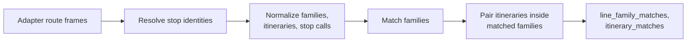

# E3.2 Route-route matching

This page explains how the engine pairs whole lines and their directions after stop matching: first line families, then itineraries inside each matched family. It is route-level matching; matching a stop to a stop with route evidence is a different rule, described in [E2.3](2.3%20GTFS%20route%20matching.md).

Two route computations exist, both in the engine. Before stop matching, a per-run `RouteState` maps OSM relations to source routes as evidence for the GTFS route rule. After stop matching, `compare_routes()` compares complete families and ordered itineraries using the matched stop identities; this page describes the second.

## Inputs

The comparison receives DataFrames from the adapters. The names are logical product names; the Swiss source products may come from same-named cache files, while the OSM products normally exist only in memory:

- `source_routes`, `source_itineraries`, `source_stop_calls`
- `osm_route_masters`, `osm_route_relations`, `osm_route_relation_members`, `osm_route_relation_stops`
- the stop-matching output, so that OSM stop calls can reuse the source identity their node was matched to

## Step 1: build the families

- **Source:** one family per `route_id`, with the normalized route identifier and the GTFS display fields (`route_short_name`, `route_long_name`).
- **OSM:** the [public transport route relations](1.3%20OSM%20data.md#which-route-relations-are-services) are grouped into families by the first available of: the parent `route_master`; the normalized `gtfs:route_id`; a synthetic key from `route`, `ref`, `operator` and `network`; the relation itself. Every relation therefore belongs to some family, even without a route master or GTFS tag.

## Step 2: match the families

Families are matched in two passes: by route identifier, then, for the OSM families still unmatched, by line number and stops. Each family appears in at most one `line_family_matches` row, and OSM families marked `is_non_gtfs` take part in neither pass. Both passes follow one rule: when in doubt, a family stays unmatched. An unmatched line is visible and a mapper can fix it; a wrong match counts as a success and hides the problem.

### By route identifier

Each candidate pair of a source family and an OSM family gets a score:

| Score | `match_method` | When |
|---|---|---|
| 1.0 | `exact_gtfs_route_id` | The OSM `gtfs:route_id` equals the source route identifier |
| 0.95 | `normalized_gtfs_route_id` | The identifiers are equal after year normalization (`-jXX`), and the stops confirm it (below) |
| 0.9 | `display_route_id_match` | The OSM family's display identifier equals the source route identifier |

Pairs are chosen greedily from the highest score down, ties broken by identifier. Only candidates reachable through these three identifier indexes are scored, which gives the same result as comparing every pair.

A Swiss route identifier contains the timetable year, as in `92-742-A-j26-1`. Normalization replaces the year with `jXX`, so a `gtfs:route_id` from another timetable year still finds its line when the rest of the identifier is the same. But the rest can change too: between timetable years an identifier can pass to another line, often one with the same number in another town. OSM still tags bus 11 around Fribourg with `92-11-H-j22-1`, and in 2026 `92-11-H-j26-1` is Basel's bus 11. A normalized pair is therefore a candidate only when the two families have the [same line number](#by-line-number-and-stops) and **share at least one stop**: a resolved source stop key on any itinerary of each. A refused pair no longer takes the source family, so another OSM family with the same old identifier that does run there can still be matched.

### By line number and stops

An OSM family still unmatched, because it has no `gtfs:route_id`, an outdated one or a refused one, is compared with the source families on what both describe:

- **Mode:** the OSM `route` against the GTFS `route_type`, basic or extended. Bus, trolleybus, minibus and coach count as bus; light rail as tram; subway and monorail as metro. A family without a known mode is never matched this way.
- **Line number:** the OSM `ref` against the GTFS `route_short_name`, ignoring case and spaces, so `IR 26` is `IR26`. The adapter can add another form of a number: the Swiss runner reads a timetable number `NN.NNN` as its line, so `31.158` is line `158`.
- **Stops:** resolved source stop keys, the stop identity of [itinerary pairing](#step-4-pair-the-itineraries).

A **candidate** of a family is a family of the other side with the same mode and line number that shares at least four stops. Its **score** is the best stop ratio of any pair of their itineraries, with the ratio of step 4 but whatever the direction: one OSM relation that serves one source itinerary's stops is the evidence that the two lines are the same. An OSM family is matched to its best candidate, as `line_number_and_stops`, when:

1. the score reaches the itinerary threshold, 0.8 (`MatchingProfile.itinerary_min_stop_ratio`);
2. that source family is still unmatched;
3. its score leads the OSM family's next candidate by at least 0.1;
4. the OSM family's score leads the source family's next candidate by at least 0.1 too.

Families matched by identifier count as candidates in points 3 and 4: an OSM line whose real counterpart is already matched does not settle for a lookalike, and two OSM lines that both resemble one source line leave it unmatched. Each rule guards against a known mistake:

| Rule | Refuses |
|---|---|
| Same line number | A line serving the same stops under another number: night line `N3` against `3`, replacement buses (`EV`), extra trains (`EXT`) |
| Same mode | A tram and a bus with the same number in one town |
| Lead of 0.1 | One line with two source identifiers on the same stops, such as `92-400` and `92-400-A` |
| Both lines choose each other | Two OSM relations of one line mapped twice, competing for it |

Then [step 4](#step-4-pair-the-itineraries) pairs the itineraries inside every matched family, whatever its `match_method`.

On the Swiss data of 6 November 2026 the pass matches 115 families, and it was checked by hiding the identifiers of all 1,660 OSM families matched exactly: it matched 974 of them to their line again, one to another line, and left the others unmatched. The one is IR 26: its tag names the short Luzern–Basel section run by SBB, while its relation serves all the stops of the Basel–Locarno line, the line the pass chose.

### Families that stay unmatched

An OSM family stays unmatched when neither pass matches it, for example:

- its identifier is not in the timetable and no source line has the same mode, number and stops, often because the relation's stops are not resolved to source stops, or its relations stop short of the source itineraries;
- the source family it points to is already matched to another OSM family with a higher score;
- two source families, or two OSM families, are too close to choose between.

The second case usually means an outdated identifier. Bern's tram 9 carries `91-9-A-j21-1` in OSM; in the 2026 timetable `91-9-A-j26-1` is the RBS S9, which carries its current identifier and takes the source family with an exact match. The tram itself is a candidate of its real line, `91-9-j26-1`, but its best itinerary shares only 75% of its stops, below the threshold.

## Step 3: build itineraries and stop calls

- **Source itineraries** come from `source_itineraries` and keep `direction_id`, `representative_headsign`, `direction_label`, `trip_count`, `shape_id` and `headsign_or_pattern_hash`.
- **OSM itineraries** are one per route relation. The direction comes from the relation's [`ref_trips`](1.3%20OSM%20data.md#the-ref_trips-tag) tag and is unknown without it; `headsign_or_pattern_hash` is a hash of its ordered stops.
- **OSM stop calls** take the first available identity: the source stop their node was matched to; else the only source stop with the call's station reference (`uic_ref`); else the raw key `uic:<uic_ref>` or `osm:<node_id>`.
- **One call per stop visit.** A relation lists a stop's stop position and platform one after the other. When two consecutive members are a `stop*` and a `platform*` member of the same stop (by the stop identity rule of step 4), they form one call, which keeps the member with a resolved source stop. Without this, an OSM itinerary would be twice as long as its source itinerary and could not reach the threshold below.

## Step 4: pair the itineraries

Inside each matched family, every source itinerary is scored against every OSM itinerary.

1. **Direction.** In the Swiss profile, both directions must be known and equal, so an OSM itinerary without `ref_trips` is never paired. The generic profile also accepts a pair where a direction is unknown, but never one with two different known directions. Because stops are compared in order (point 2), an itinerary run in the opposite direction scores low even without a direction.
2. **Ordered stops.** The two stop lists are aligned in order, by longest common subsequence: a stop may be skipped on either side, but the order cannot go backwards and each call is used once.
3. **Stop identity.** Two calls are the same stop when their resolved source stop keys (`source_stop_key` and `source_stop_key_variants`) share a value. When at least one call has no resolved key, equal `station_ref` values count; two calls with different resolved identities never match. Prefixes and fallback keys are never treated as resolved identities.
4. **Threshold.** The pair is eligible when

   **shared stops in order ÷ max(source stop count, OSM stop count) ≥ 0.8**

   Dividing by the longer list keeps a short itinerary that lies inside a long one from scoring 100%.

Eligible pairs are chosen greedily, one-to-one: more shared stops first, then the higher ratio, then the lower itinerary identifiers.

Each `itinerary_matches` row records its scores: `direction_score` (1 or 0), `stop_score` (the ratio above), `overall_score` (currently equal to `stop_score`), `geometry_score` (not computed, always empty) and `match_reason`:

| `match_reason` | Meaning |
|---|---|
| `ordered_stop_match` | Eligible, with equal directions |
| `ordered_stop_match_direction_unknown` | Eligible in a generic profile, with a direction missing; its `direction_score` is 0 |
| `direction_mismatch` | Directions disagree, or are missing in the Swiss profile |
| `below_stop_match_threshold` | Directions agree, but too few stops are shared |

`MatchingProfile.itinerary_require_direction` and `itinerary_min_stop_ratio` set the direction rule and the threshold.

## Code

`compare_routes()` and the scoring helpers in [routes.py](../src/osm_public_transport_matcher/routes.py); the Swiss timetable form of line numbers is `timetable_line_number()` in [swiss.py](../src/osm_public_transport_matcher/swiss.py).

## Related pages

- [E3.1 Route data flow](3.1%20Route%20Pipeline%20Data%20Flow.md)
- [E1.2 GTFS and ATLAS](1.2%20GTFS%20ATLAS%20data.md) and [E1.3 OSM data](1.3%20OSM%20data.md)
- [A2.6 Routes pages](https://github.com/openTdataCH/stop_sync_osm_atlas/blob/main/documentation/2.6%20Routes%20Pages.md): how reviewers browse the matched and unmatched routes
