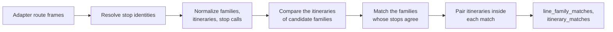

# E3.2 Route-route matching

This page explains how the engine pairs whole lines and their directions after stop matching. It compares the itineraries of the lines that could be the same, matches the line families whose itineraries agree, and pairs the itineraries inside each match. It is route-level matching; matching a stop to a stop with route evidence is a different rule, described in [E2.3](2.3%20GTFS%20route%20matching.md).

Two route computations exist, both in the engine. Before stop matching, a per-run `RouteState` maps OSM relations to source routes as evidence for the GTFS route rule. After stop matching, `compare_routes()` compares complete families and ordered itineraries using the matched stop identities; this page describes the second.

## Inputs

The comparison receives DataFrames from the adapters. The names are logical product names; the Swiss source products may come from same-named cache files, while the OSM products normally exist only in memory:

- `source_routes`, `source_itineraries`, `source_stop_calls`
- `osm_route_masters`, `osm_route_relations`, `osm_route_relation_members`, `osm_route_relation_stops`
- the stop-matching output, so that OSM stop calls can reuse the source identity their node was matched to

## Step 1: build the families

- **Source:** one family per `route_id`, with the normalized route identifier and the GTFS display fields (`route_short_name`, `route_long_name`).
- **OSM:** the [public transport route relations](1.3%20OSM%20input%20and%20acquisition.md#which-route-relations-are-services) are grouped into families by the first available of: the parent `route_master`; the normalized `gtfs:route_id`; a synthetic key from `route`, `ref`, `operator` and `network`; the relation itself. Every relation therefore belongs to some family, even without a route master or GTFS tag.

## Step 2: build itineraries and stop calls

- **Source itineraries** are the rows of `source_itineraries`, with the direction, headsign and trip count that the adapter gives ([fields](Result%20bundle%20format.md#routes)).
- **Source stop calls** take the resolved source stop as their platform, and that stop's station as `station_ref`; a call without a resolved stop keeps the station the adapter gives. A Swiss trip without a planned platform calls at the station's SLOID, such as `ch:1:sloid:1075` for Lausanne-Ouchy (lac), so it resolves to no platform and the station is how it is compared ([E1.2](1.2%20Swiss%20GTFS%20and%20ATLAS.md#source_stop_callscsv)). The resolved stop's station wins because the feed can file a platform under a neighbouring station, such as a platform of Zürich HB SZU under Zürich HB.
- **OSM itineraries** are one per route relation. The direction comes from the relation's [`ref_trips`](1.3%20OSM%20input%20and%20acquisition.md#the-ref_trips-tag) tag and is unknown without it.
- **OSM stop calls** take the first available identity: the source stop their node was matched to; else the only source stop with the call's station reference (`uic_ref`); else the raw key `uic:<uic_ref>` or `osm:<node_id>`.
- **One call per stop visit.** A relation lists a stop's stop position and platform one after the other. When two consecutive members are a `stop*` and a `platform*` member of the same stop (by the stop identity rule of step 3), they form one call, which keeps the member with a resolved source stop. This holds also when stop matching linked the two members to different platforms of the station. Without this, an OSM itinerary would be twice as long as its source itinerary and could not reach the threshold of step 3.

## Step 3: compare two itineraries

A source itinerary and an OSM itinerary are compared on their stops in order. The same comparison matches the families (step 4) and pairs the itineraries (step 5).

1. **Ordered stops.** The two stop lists are aligned in order, by longest common subsequence: a stop may be skipped on either side, but the order cannot go backwards and each call is used once. An itinerary run in the opposite direction therefore shares few stops in order.
2. **Stop identity.** Two calls are the same stop when they are at the same platform, or at the same station. The same platform means that their resolved source stop keys (`source_stop_key` and `source_stop_key_variants`) share a value; the same station, equal `station_ref` values. Prefixes and fallback keys are never treated as resolved identities. A call at another platform of the station still serves that stop: which platform a train or bus uses is a question for stop matching, and one source itinerary groups trips that use different tracks.
3. **Stop ratio.**

   **shared stops in order ÷ max(source stop count, OSM stop count)**

   Dividing by the longer list keeps a short itinerary that lies inside a long one from scoring 100%. Two itineraries share enough stops when the ratio reaches 0.8 (`MatchingProfile.itinerary_min_stop_ratio`).

## Step 4: match the families

A family has no stops of its own: what two families share is what one itinerary of each shares. Families are therefore matched from one table of candidates, in which the itineraries of every candidate are compared once. One rule decides: when in doubt, a family stays unmatched. An unmatched line is visible and a mapper can fix it; a wrong match counts as a success and hides the problem.

### Candidates

A source family and an OSM family are candidates when the OSM route identifier names the source family, or when they have the same mode and line number. OSM families marked `is_non_gtfs` are never candidates.

**Route identifier.** The identifier names the source family in one of three ways, which is also the `match_method` of the match:

| `match_method` | When |
|---|---|
| `exact_gtfs_route_id` | The OSM `gtfs:route_id` equals the source route identifier |
| `normalized_gtfs_route_id` | The identifiers are equal after year normalization (`-jXX`) |
| `display_route_id_match` | The OSM family's display identifier equals the source route identifier |

A Swiss route identifier contains the timetable year, as in `92-742-A-j26-1`. Normalization replaces the year with `jXX`, so a `gtfs:route_id` from another timetable year still finds its line when the rest of the identifier is the same. Only pairs reachable through these three identifier indexes are looked at, which gives the same result as comparing every pair.

**Mode and line number.**

- **Mode:** the OSM `route` against the GTFS `route_type`, basic or extended. Bus, trolleybus, minibus and coach count as bus; light rail as tram; subway and monorail as metro. A family without a known mode is no candidate this way.
- **Line number:** the OSM `ref` against the GTFS `route_short_name`, ignoring case and spaces, so `IR 26` is `IR26`. The adapter can add another form of a number: the Swiss runner reads a timetable number `NN.NNN` as its line, so `31.158` is line `158`.

Two families without a stop in common share nothing, so the candidates by mode and number are searched among the families that serve a same platform or station.

### What two candidates share

Every itinerary of the source family is compared with every itinerary of the OSM family, as in step 3 and whatever their direction. The candidate keeps:

- its **stop score**: the best stop ratio of two itineraries that share at least two stops. One OSM relation that serves one source itinerary's stops is the evidence that the two lines are the same. A single shared stop shows no order, so a pair of one-stop itineraries does not count;
- whether any pair **shares a stop**;
- whether the two families have the **same line number**.

The **stops agree** when the stop score reaches the ratio of step 3, 0.8. With that ratio, two itineraries of five stops or more share at least four, and two shorter ones share all their stops: a cableway or funicular with two or three stations agrees with the line of the same number at those stations.

### The match

1. **By the stops.** Every candidate whose stops agree is matched. A family can be matched to several families of the other side:
   - **Several source families, one OSM family.** The timetable splits one line into several route identifiers. IR 26 is `91-26-C` for one operator and `91-26-D` for another, and `92-400` and `92-400-A` run on the same stops; OSM maps each line once.
   - **Several OSM families, one source family.** OSM holds a line twice, or in two parts: relations outside the route master of their line, or two route masters for one line.

   Nothing is refused because another family fits too. How many families a family is matched to is a fact of the result, and a source family matched to several OSM families is a case to review.
2. **By the route identifier alone.** A source family whose stops agree with no OSM family is matched to the OSM family that carries its identifier, when one itinerary of each shares a stop. The identifier is a mapper's statement of the line, and a relation that lists few stops cannot reach the ratio.
   - **A normalized identifier also needs the same line number.** Between timetable years an identifier can pass to another line, often one with the same number in another town. A bus 11 tagged `92-11-H-j22-1` in one town and a bus 11 that carries `92-11-H-j26-1` in another town have the same normalized identifier and the same number, but no stop in common, so they are not matched.
   - **Several OSM families can carry the identifier.** The one with the same line number comes first, then the kind of identifier in the order of the table above, then the higher stop score, by at least 0.1. Two that stay equal are both left unmatched.

An OSM family that carries a source family's identifier but not its stops stays unmatched when the stops find another family. OSM buses 521 and 523 both carry the identifier of source bus 521. OSM bus 521 serves its stops and is matched by them; OSM bus 523 shares half of them and is not matched.

Each `line_family_matches` row records its `match_method`, the way the route identifier names the source family or `line_number_and_stops` without one, and its `stop_score`. A row with an identifier and a `stop_score` below the ratio is a match by the identifier alone.

Each condition guards against a known mistake:

| Condition | Refuses |
|---|---|
| Same line number | A line serving the same stops under another number: night line `N3` against `3`, replacement buses (`EV`), extra trains (`EXT`) |
| Same mode | A tram and a bus with the same number in one town |
| Two shared stops in order | Two lines of the same number that meet at one stop |
| A shared stop for a route identifier | An identifier typed on a line elsewhere |

### Families that stay unmatched

A family stays unmatched when it has no candidate whose stops agree and no identifier that matches it alone, for example:

- no family of the other side has its identifier, or its mode and number at a shared stop;
- its candidate serves too few of the same stops in order, often because the relation's stops are not resolved to source stops, or its relations stop short of the source itineraries;
- it carries the identifier of a source family whose stops agree with another OSM family, which usually means an outdated or copied identifier;
- its normalized identifier names a line with another number, or one with no stop in common.

## Step 5: pair the itineraries

Inside each match, the itineraries are paired from the comparisons of step 4. A pair is eligible when it passes two conditions:

1. **Enough stops.** The stop ratio of step 3 reaches 0.8.
2. **Direction.** Two itineraries with different known directions are never paired. A pair where a direction is unknown, such as an OSM relation without `ref_trips`, is paired on its stops. Because stops are compared in order, an itinerary run in the opposite direction scores low even without a direction. The order of the relation's members is what counts, also when its `from` and `to` tags say the opposite. A relation whose `ref_trips` names the other direction than its stops is not paired: the tag is a mapper's to fix.

Eligible pairs are chosen greedily, one-to-one, in this order:

1. **Equal directions.** A pair whose directions are known and equal comes before a pair with an unknown direction.
2. **The same ends.** A pair whose first stops and last stops are the same (by the stop identity of step 3) comes first, then a pair sharing one of its ends.
3. **The higher stop ratio.**
4. **More shared stops.**
5. **More shared platforms**, in order.
6. **The lower itinerary identifiers.**

Equal directions come first so that an itinerary without a direction only takes a partner that the itineraries with a direction left free. The S36 *Bülach → Koblenz* shows why: the source itineraries to Koblenz and to Waldshut have the same stops in Switzerland, and the relation whose `ref_trips` names one of them keeps it.

The ends rank pairs but are not required: a stop missing or added at an end, or a terminus that stop matching left unidentified, still allows a pair that shares enough stops. Among the itineraries that do, the one with the same terminus wins, also over one that shares a stop more by running further: a relation *A → B* pairs with the source itinerary that ends at B, not with the one that runs on to C.

The choice is one-to-one inside a match. An itinerary of a family with several matches can be paired once in each: the relation of an OSM line matched to two source families with the same stops is paired with an itinerary of each.

Each `itinerary_matches` row records its `stop_score` (the stop ratio) and its `match_reason`. Only eligible pairs are chosen, so a row carries one of the first two reasons; the scoring gives the last two to the pairs it refuses, which are not exported:

| `match_reason` | Meaning |
|---|---|
| `ordered_stop_match` | Eligible, with equal directions |
| `ordered_stop_match_direction_unknown` | Eligible, with a direction missing |
| `direction_mismatch` | Two known directions differ, or a direction is missing in a profile that requires it |
| `below_stop_match_threshold` | The directions pass, but too few stops are shared |

`MatchingProfile.itinerary_min_stop_ratio` sets the threshold. A profile that sets `itinerary_require_direction` pairs only itineraries whose directions are known and equal; neither the generic nor the Swiss profile sets it.

## Code

| File | Role |
|---|---|
| `src/osm_public_transport_matcher/routes.py` | `compare_routes()` and the scoring helpers |
| `src/osm_public_transport_matcher/swiss.py` | `timetable_line_number()`: the Swiss timetable form of line numbers |

## Related pages

- [E3.1 Route data flow](3.1%20Route%20data%20flow.md)
- [E1.2 GTFS and ATLAS](1.2%20Swiss%20GTFS%20and%20ATLAS.md) and [E1.3 OSM data](1.3%20OSM%20input%20and%20acquisition.md)
- [A2.6 Routes pages](https://github.com/openTdataCH/stop_sync_osm_atlas/blob/main/documentation/2.6%20Routes%20pages.md): how reviewers browse the matched and unmatched routes
