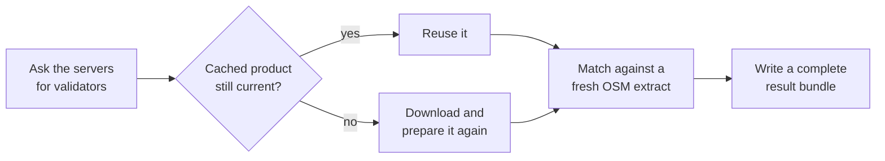

# E5.1 Source snapshot caching

Downloading and preparing the Swiss sources takes much longer than matching them, and the sources change rarely. Acquisition therefore caches each prepared product and reuses it as long as it can prove the product is still current. This page explains that rule; [E5.2](5.2%20Pipeline%20Performance.md#independent-cache-stages) has the detailed dependency table.



## When a cached product is reused

`adapters/acquisition.py` reuses a product only when both hold:

1. the server's HTTP validator (ETag or Last-Modified) is unchanged, and
2. the cached files still have the SHA-256 fingerprints recorded when they were made.

A stable download URL or file name alone is never enough. A changed boundary, a new cache format version or ATLAS rows that have expired since the last run invalidate the affected products too. OSM is downloaded on every full run.

Each run's bundle is complete, whatever was reused: a consumer never depends on an earlier run's data. The review application imports every bundle in full and does not inspect the cache.

## Independent stages

Acquisition checkpoints four stages separately: the filtered ATLAS platforms, the downloaded GTFS files, the parsed GTFS patterns, and the GTFS-to-ATLAS mapping. Each stage records its inputs and the fingerprints of its outputs in `data/source_metadata.json`, so:

- an ATLAS-only update reuses the parsed GTFS feed;
- a failed OSM download does not discard the finished ATLAS and GTFS work, so the next run continues from there;
- an interrupted stage no longer matches its checkpoint and is rebuilt.

`--force` rebuilds every stage. It applies to acquisition, so combine it with `--download`; result directories are never overwritten either way:

```bash
public-transport-matcher swiss --workspace /path/to/workspace --download --force --output /path/to/new-result
```

Run one acquisition per workspace at a time; separate workspaces can run concurrently.
