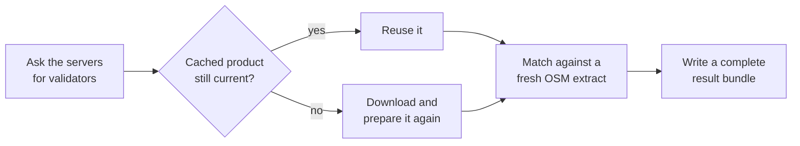
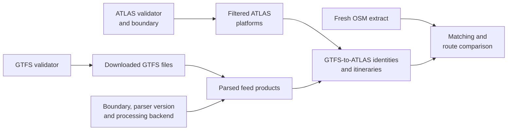

# E5.1 Source snapshot caching

Downloading and preparing the Swiss sources takes much longer than matching them, and the sources change rarely. Acquisition therefore caches each prepared product and reuses it as long as it can prove the product is still current. This page explains that rule, the cache stages and what invalidates each of them.



## When a cached product is reused

`src/osm_public_transport_matcher/adapters/acquisition.py` reuses a product only when both hold:

1. the server's HTTP validator (ETag or Last-Modified) is unchanged, and
2. the cached files still have the SHA-256 fingerprints recorded when they were made.

A stable download URL or file name alone is never enough, and modification times are never trusted. A source whose server sends neither validator is downloaded again on every run. A changed boundary, a new cache format version or ATLAS rows that have expired since the last run invalidate the affected products too. OSM is downloaded on every full run.

Each run's bundle is complete, whatever was reused: a consumer never depends on an earlier run's data. The review application imports every bundle in full and does not inspect the cache.

## Independent stages

Acquisition checkpoints four stages separately: the filtered ATLAS platforms, the downloaded GTFS files, the parsed GTFS products, and the GTFS-to-ATLAS identities and itineraries. Each stage depends only on its own inputs:



`data/source_metadata.json` records the cache version (2) and, for each stage, its inputs, the SHA-256 fingerprints of its outputs and the server's validators. Metadata with another cache version is ignored, so every stage is rebuilt. The cache version and the bundle's schema version are unrelated numbers. The processing backend is `GTFS_PROCESSING_BACKEND` ([E5.2](5.2%20Pipeline%20performance.md#settings-and-logs)).

| Change | Work done |
|---|---|
| Nothing upstream | Verify the cached outputs; download OSM; match and write the bundle |
| Only ATLAS | Download and filter ATLAS; reuse the parsed GTFS; rebuild the identities and itineraries if the filtered ATLAS content changed |
| GTFS | Download and parse GTFS; rebuild the dependent identities and itineraries; reuse ATLAS |
| The boundary | Download and filter ATLAS again and reparse GTFS; reuse the verified GTFS download |
| A derived itinerary file is missing or changed | Rebuild the identities and itineraries from the verified parsed GTFS |
| The parsed GTFS cache is missing or changed | Rebuild it from the verified raw GTFS, downloading again if its freshness or integrity cannot be established |
| ATLAS rows expired | Download and filter ATLAS again, even when the server's validator is unchanged |
| `--force` | Rebuild every source and preparation stage |

The large raw GTFS files are verified only when they are needed to rebuild the parsed products.

Downloads land in a temporary directory inside the workspace and replace the cached files only after they succeed. Each successful stage writes its checkpoint before the next stage begins, so:

- an ATLAS-only update reuses the parsed GTFS products;
- a failed OSM download does not discard the finished ATLAS and GTFS work, so the next run continues from there;
- an interrupted stage is rebuilt by the next run, because its files do not match its checkpoint or its inputs have changed.

Acquisition failures never touch a published result. Each reuse or rebuild is logged as a `cache_decision` record with its reason ([E5.2](5.2%20Pipeline%20performance.md#settings-and-logs)).

## Running acquisition

`--download` performs the freshness checks and refreshes the workspace; `--workspace` without `--download` reruns matching on the inputs already there. `--force` rebuilds every stage. It applies to acquisition, so combine it with `--download`; result directories are never overwritten either way:

```bash
osm-public-transport-matcher swiss --workspace /path/to/workspace --download --force --output /path/to/new-result
```

Run one acquisition per workspace at a time; separate workspaces can run concurrently.

## Code

| File | Role |
|---|---|
| `src/osm_public_transport_matcher/adapters/acquisition.py` | `refresh_swiss()`: the cache stages, their checkpoints in `source_metadata.json` and the `cache_decision` records |
| `src/osm_public_transport_matcher/adapters/source_freshness.py` | Asks the servers for their ETag and Last-Modified validators and compares them with the recorded ones |
| `src/osm_public_transport_matcher/adapters/gtfs_columnar.py` | Writes and reads the parsed GTFS products in `data/cache/gtfs` |
| `src/osm_public_transport_matcher/cli.py` | The `--download`, `--workspace` and `--force` options |
| `tests/test_adapters_acquisition.py` | Cold and warm reuse, changed sources, expired ATLAS rows, corrupt caches and failure recovery |

## Related pages

- [E1 Input integrations & acquisition](1.%20Input%20integrations%20%26%20acquisition.md#download-a-swiss-workspace): the workspace layout
- [E1.1 ATLAS stops](1.1%20Swiss%20ATLAS%20stops.md) and [E1.2 GTFS and ATLAS](1.2%20Swiss%20GTFS%20and%20ATLAS.md): the products that are cached
- [E5.2 Pipeline performance](5.2%20Pipeline%20performance.md#settings-and-logs): the settings and the `cache_decision` logs
- [A3.3 Background scheduler](https://github.com/openTdataCH/stop_sync_osm_atlas/blob/main/documentation/3.3%20Background%20scheduler.md): how the review application runs acquisition on a schedule
