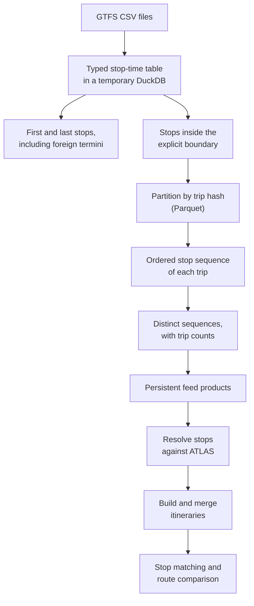
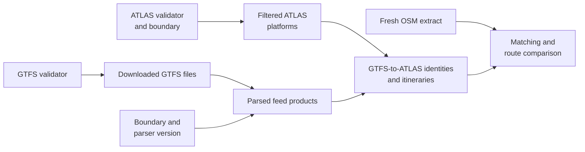

# E5.2 Pipeline performance

A national Swiss run processes tens of millions of timetable rows and a nationwide OSM extract. This page explains what keeps it fast: reducing GTFS trips early, caching stages independently, indexed route comparison and fast bundle compression. It also lists the settings and logs, and how to reproduce the measurements. Results depend on the feed, storage, memory and concurrent work; the measurements below are dated local observations, not guarantees.

## GTFS: many trips, few patterns

`stop_times.txt` lists every trip, and most trips repeat the same ordered stops. The Swiss adapter therefore reduces trips to distinct patterns inside an embedded DuckDB database before any Python itinerary object is built. No DuckDB service or database connection is involved.



The implementation, `src/osm_public_transport_matcher/adapters/gtfs_columnar.py`, keeps these properties:

- Identifiers stay strings, leading zeros included. Only the numeric `stop_sequence` orders calls, and a repeated visit to the same stop stays a separate call.
- First and last stops are taken before geographic filtering, so direction labels keep their termini abroad.
- 256 hash partitions keep every trip together, even when its rows are interleaved with other trips; trip metadata is partitioned the same way. Partitions bound working memory, but one extreme trip or partition can still exceed the budget.
- Trips are reduced by route, direction, headsign (or short name when there is no headsign) and ordered raw stop IDs. Trip counts are summed and the first representative provides the sequence numbers. Different platform sequences stay separate until the identity mapping merges them as variants.
- Python receives the reduced patterns and only the trip metadata they need.
- Identity decisions, sequence hashes, dominant-pattern selection and itinerary thresholds are the same as in the pandas path.

Temporary DuckDB tables and partition files live in the process temporary directory and are removed when processing ends. Reusable products are Parquet files in `data/cache/gtfs`.

`GTFS_PROCESSING_BACKEND=pandas` selects the chunked pandas reference reader, used for comparison and troubleshooting. It assumes that a trip's rows are not spread across chunks; the DuckDB path handles interleaved trips. The DuckDB path serves the Swiss acquisition and runner; the generic `osm-public-transport-matcher gtfs` adapter is a separate implementation that has not been benchmarked at national scale.

## Independent cache stages



`data/source_metadata.json` records the cache version (2), each stage's dependencies, SHA-256 fingerprints of its outputs and the servers' validators. A version-1 cache triggers one full rebuild. The cache version and the bundle's schema version are unrelated numbers.

| Change | Work done |
|---|---|
| Nothing upstream | Verify the cached outputs; download OSM; match and publish |
| Only ATLAS | Download and filter ATLAS; reuse the parsed GTFS; remap if the filtered ATLAS content changed |
| GTFS | Download and parse GTFS; rebuild the dependent identities and itineraries; reuse ATLAS |
| The boundary | Filter ATLAS again and reparse GTFS; reuse the verified GTFS download |
| A derived itinerary file is missing or changed | Rebuild the mapping products from the verified parsed GTFS |
| The parsed GTFS cache is missing or changed | Rebuild it from the verified raw GTFS, downloading again if its freshness or integrity cannot be established |
| ATLAS rows expired | Filter ATLAS again, even when the server's validator is unchanged |
| `--force` | Rebuild every source and preparation stage |

An ETag or Last-Modified validator is required to establish freshness; a stable URL or ZIP name is not enough. File hashes validate local products; modification times are never trusted. The multi-gigabyte raw GTFS files are verified only when they are needed to rebuild parsed products.

Each successful stage writes its checkpoint before the next stage begins, so a network failure after GTFS processing leaves that work reusable. A crash during a stage leaves files that no longer match its checkpoint, so the stage is rebuilt. Acquisition failures never touch a published result. Run one acquisition per workspace at a time.

`--workspace` without `--download` reruns matching on the existing inputs; `--download` performs the freshness checks; `--force` applies to acquisition and should be combined with `--download`.

## Route comparison and OSM processing

- **Family matching** builds three indexes, by exact GTFS route ID, normalized route ID and display route ID, and scores only the candidates reachable through them. Scores and the final ordering by score and identifiers are the same as for an exhaustive comparison, so the greedy choice is unchanged.
- **Itinerary matching** uses longest-common-subsequence dynamic programming. Identity sets and parsed variant lists are prepared before the inner loop. Only the score is needed, so a single rolling row keeps memory linear.
- **OSM routes:** route construction does not materialize unused way-member records, and only the call frame that is modified is copied when keys are scoped. The runner builds the OSM route products once from the current XML.

## Bundle compression

Bundles are compressed with gzip level 1 by default, which encodes faster than Python's default level 9 at the cost of larger files. `--compression-level 0` to `9` changes it on the CLI; the Python writer takes `compresslevel=`. Readers and the schema are unaffected, and validation, checksums and the atomic publication always run.

## Database loading

Loading a bundle into the review database is the review application's work. It uses PostgreSQL `COPY` into a private staging schema, builds secondary indexes after the load, and publishes in one short transaction; see [A1.1 Bundle import and publication](https://github.com/openTdataCH/stop_sync_osm_atlas/blob/main/documentation/1.1%20Import%20Process.md#loading-performance).

## Settings and logs

| Setting | Engine default | Meaning |
|---|---|---|
| `GTFS_PROCESSING_BACKEND` | `duckdb` | `pandas` selects the comparison path |
| `GTFS_THREADS` | `2` | DuckDB worker threads |
| `GTFS_MEMORY_LIMIT` | `768MB` | DuckDB's managed memory budget; **not** a limit on the whole process or container. The review application's Compose file sets `1536MB` for its scheduler. |
| `--compression-level` | `1` | Gzip level of the new bundle |

More threads can raise memory use; benchmark before increasing both threads and memory. Python's stop and trip tables and the matching state use memory on top of DuckDB, and the native tables and partitions need temporary disk space.

Log records are JSON objects with the event `stage_started`, `stage_progress`, `stage_finished` or `stage_failed`. Long stages report every 30 seconds. Finished records give wall-clock and process CPU seconds; CPU time covers all threads and can exceed wall time. Nested stages overlap, so their durations must not be added up.

GTFS logs separate metadata loading, scanning, filtering and termini, partitioning, pattern reduction, identity matching, itinerary construction and cache input and output, and report input bytes and the reduced row, trip and pattern counts. `cache_decision` records explain each reuse or rebuild: changed inputs, missing or corrupt products, expired ATLAS rows, a forced rebuild or an unverifiable source.

## Reproduce the measurements

Install the Swiss extra and run each backend in a fresh process on the **same** files. These commands neither download nor change source data:

```bash
python -m pip install -e '.[swiss,test]'
python benchmarks/gtfs.py --gtfs /path/to/gtfs --atlas /path/to/stops_ATLAS.csv --boundary /path/to/switzerland.geojson --backend pandas --report /tmp/gtfs-pandas.json
python benchmarks/gtfs.py --gtfs /path/to/gtfs --atlas /path/to/stops_ATLAS.csv --boundary /path/to/switzerland.geojson --backend duckdb --report /tmp/gtfs-duckdb.json --compare /tmp/gtfs-pandas.json
python -m pytest tests -q
```

The benchmark records wall and CPU time, peak memory of the process, product counts and content hashes. `--compare` ignores row order and compares the actual route, itinerary, stop-call and identity products. Run on an otherwise idle machine and repeat when evaluating hardware settings; the memory figure includes Python state and the benchmark's inputs, not only DuckDB.

The tests cover equal products of both backends, repeated calls, platform variants, foreign termini, leading-zero identifiers, missing directions, interleaved trips and empty selections, and compare indexed route candidates with exhaustive scoring and the rolling-row score with an exhaustive longest common subsequence.

## Measured results

The record [benchmarks/pipeline-performance-2026-09-12.json](benchmarks/pipeline-performance-2026-09-12.json) holds the measurements of 12 September 2026, with their environments, product hashes and limitations. They are single runs; some reference and container runs overlapped other work, so they are not a controlled speed-up study.

| Work | Before | After |
|---|---:|---:|
| Fresh GTFS preprocessing, macOS | 31 min 7 s (pandas) | 3 min 37 s (DuckDB) |
| Runner on cached GTFS products | 180.83 s | 100.24 s |
| Route comparison within that run | 95.50 s | 20.69 s |
| National import into the review database, 4 GiB container | 11 min 22 s | 3 min 14 s |

Both GTFS backends produced identical product hashes in the same environment. A Linux run within 4 GiB made identical decisions, with tiny floating-point differences in distances. The parsed GTFS cache took 21.1 MiB; 1.70 million relevant trips reduced to 79,685 patterns.

Gzip level 1 produced a 40.76 MiB bundle in 55.90 s; level 9 produced 29.48 MiB in 65.07 s, with identical records.

For current verification, rerun the commands above and the [engine tests](6.%20Pipeline%20tests.md); the dated numbers do not replace fresh evidence.

## Technical references

- [DuckDB CSV loading](https://duckdb.org/docs/stable/data/csv/overview.html): typed CSV input and parallel reading.
- [DuckDB Parquet support](https://duckdb.org/docs/stable/data/parquet/overview.html): columnar storage and partitioned processing.
- [PostgreSQL bulk loading](https://www.postgresql.org/docs/16/populate.html): `COPY`, and loading before building secondary indexes.
