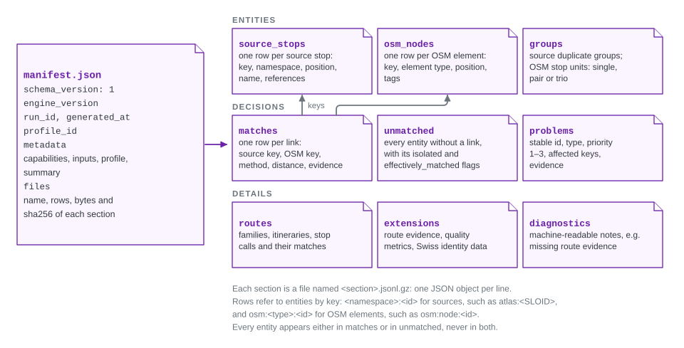

# Result bundle format

A result bundle is the complete output of one engine run and the only data contract between the engine and its consumers, such as the review application. This page is the reference for schema 1: what the files contain, how records refer to each other, and what producers and consumers must guarantee.



A bundle is one immutable directory. `manifest.json` describes the run and lists the nine record files with their checksums. The files hold entities, decisions and details.

## Versions

Two independent version numbers appear in every manifest:

| Field | Example | Changes when |
|---|---|---|
| `schema_version` | `1` | The meaning or required shape of a field changes. Consumers reject versions they do not support. |
| `engine_version` | `0.1.0` | The engine is released, including matching changes that keep the format. |

Adding optional metadata is compatible: consumers ignore what they do not know. Any other change needs a new schema version and a coordinated consumer release. `tests/fixtures/result-v1` in the review application repository is the consumer compatibility fixture.

## Files

Every section is a UTF-8 JSON Lines file compressed with gzip, named `<section>.jsonl.gz`: one JSON object per line. All nine files are always present; an empty section is an empty gzip stream. File names are fixed and never contain directories.

| Section | One row per | Principal fields |
|---|---|---|
| `source_stops` | source stop | `key`, `namespace`, `source_id`, `lat`, `lon`, `name`, `platform_code`, `station_ref`, `operator`, `operator_id`, `operator_name`, `references`, `parent_id`, `stop_kind`, `extensions` |
| `osm_nodes` | positioned OSM element | `key`, `node_id`, `element_type`, `lat`, `lon`, `tags`, the projected tags `name`, `local_ref`, `uic_ref`, `uic_name`, `public_transport`, `railway`, `amenity`, `aerialway`, `network`, `operator`, `lifecycle`, and optionally `station_reference` |
| `matches` | link between a source stop and an OSM element | `source_key`, `osm_key`, `method`, `distance_m`, `notes`, `evidence`, `problems` |
| `unmatched` | entity without any match | `side` (`source` or `osm`), `key`, `isolated`; OSM rows also `effectively_matched` and `disused` |
| `groups` | source duplicate group or OSM stop unit | see [Groups](#groups) |
| `problems` | detected problem | `problem_id`, `problem_type`, `priority` (1–3), `source_keys`, `osm_ids`, `evidence` |
| `routes` | named route collection | `kind`, `value`; see [Routes](#routes) |
| `extensions` | named extension | `kind`, `value`; see [Extensions](#extensions) |
| `diagnostics` | machine-readable note | `code`, plus a stage, reason or other details |

No Python pickle, ORM object, credential or path needed for reading crosses the boundary.

## Manifest

```json
{
  "schema_version": 1,
  "engine_version": "0.1.0",
  "run_id": "a-unique-run-identifier",
  "generated_at": "2026-09-11T12:00:00+00:00",
  "profile_id": "generic",
  "metadata": {
    "capabilities": ["stops", "problems"],
    "profile": {},
    "inputs": [],
    "summary": {}
  },
  "files": {
    "source_stops": {
      "name": "source_stops.jsonl.gz",
      "rows": 2,
      "bytes": 123,
      "sha256": "sha256-of-the-compressed-file"
    }
  }
}
```

The example shows one entry of `files`; a real manifest has all nine. `bytes` and `sha256` describe the compressed file, `rows` the number of decoded objects. `metadata` carries the run's provenance: the [capabilities](#capabilities), the complete dataset profile, a summary of counts, and a fingerprint (name, SHA-256, size) of every input file the adapters actually read. Integrations add their own metadata, such as attribution and acquisition details.

`metadata.warnings`, when present, is a list of sentences about input problems that weakened the run without stopping it, such as a missing ATLAS column ([E1.1](1.1%20ATLAS%20stops.md#filters)). A consumer shows them with the run. The Swiss `metadata.acquisition` records `last_overpass_query_at`, when Overpass was queried, and `osm_data_at`, the Overpass `osm_base` time of the data it returned ([E1.3](1.3%20OSM%20data.md#the-download)).

## Keys and identities

Rows refer to entities by key, never by position.

- **Source keys** are `<namespace>:<source_id>`, for example `atlas:ch:1:sloid:3000:501:33`. A namespace never contains a colon, so equal raw identifiers from different feeds stay distinct. `references` lists the stop's identifiers as `{namespace, value, scope}` objects.
- **OSM keys** include the element type: `osm:node:123`, `osm:way:123`, `osm:relation:123`. The `node_id` field keeps the adapter's convention, in which non-node elements carry a type prefix (`way_123`), so that group members stay unambiguous. A positioned way is represented by one point; the format does not describe full geometries.
- **Coordinates** are finite WGS84 latitude and longitude. `(0, 0)` is a valid position, not a missing value.
- **`station_reference`** is an optional normalized station value, chosen by the profile's `osm_station_ref_tag`. The original `tags` and `uic_ref` are kept unchanged; display code should use them.

## Matches and unmatched entities

- A match links two existing entities and has a finite, non-negative `distance_m` in metres. `method` is the [match type](https://github.com/openTdataCH/stop_sync_osm_atlas/blob/main/documentation/0.1%20Glossary.md#match-type): the rule and branch that decided the match, such as `uic_reference_local_ref` or `gtfs_shared_route` ([E2](2.%20Matching%20process.md#the-matching-rules)).
- An entity can have several matches when the profile allows it, but the same pair never appears twice.
- Every entity appears either in `matches` or in `unmatched`, never in both and never in neither.
- `isolated` is true when no element of the other side lies within the profile's isolation radius.
- `effectively_matched` marks the middle of a PTv2 two-sided stop whose two sides are matched. It does not create a match for the middle.
- `disused` marks a [disused OSM element](1.3%20OSM%20data.md#disused-stops): one whose `osm_nodes` row has a `lifecycle`, the prefix of a retired stop tag such as `disused`. `lifecycle` is null for active elements. The disused rows are exactly the rows with a `lifecycle`, so such an element is never matched or effectively matched; the producer writes it with `isolated: false`. A missing `disused` counts as false, so earlier schema 1 bundles stay valid.

## Groups

A **source duplicate group** has `side: "source"`, `kind: "duplicate"`, its representative `key`, and `members`: at least two distinct source keys of the same namespace. Groups never overlap.

An **OSM stop unit** has `side: "osm"`, `stop_kind` (`single`, `pair` or `two_sided_stop`), `group_kind` (the grouping branch, for example `ptv2_pair_uic_ref`), `representative_node_id` and `members` of `{node_id, member_role}`. The roles are `single`; `pair_a` and `pair_b`; or `middle` and two `side`. Every OSM element belongs to exactly one stop unit; a disused element is always a `single` unit.

## Problems

Each problem has a stable `problem_id`, derived from its type and the sorted keys of the entities it affects; its `evidence` can change between runs without changing that identity. A future review workflow can compare evidence to decide whether an earlier review still applies.

Each match row repeats the problems of that pair (type, priority and duplicate flags) in its `problems` field; the same problems appear in the `problems` section with their keys and evidence. Every unmatched source stop, and every unmatched OSM element that is neither effectively matched nor disused, has an `unmatched` problem; the other OSM elements have none. A `disused` problem lists only disused elements in `osm_ids` and no `source_keys`; its evidence holds `lifecycle` and `conflicting_source_keys` ([E4.1](4.1%20Stop%20Problems.md#disused-problems)).

## Routes

The `routes` section holds one row per collection. Each `value` is the complete collection:

| `kind` | One row per | Principal fields |
|---|---|---|
| `source_routes` | route of the source timetable | `route_id`, `route_id_normalized`, `agency_id`, `route_short_name`, `route_long_name`, `route_desc`, `route_type` |
| `osm_route_relations` | OSM `type=route` relation | `relation_id`, `route`, `ref`, `name`, `from_name`, `to_name`, `operator`, `network`, `gtfs_route_id`, `route_master_id` and further PTv2 tags |
| `line_families` | line on either side | `id`, `side`, `key`, `family_origin`, `public_name`, `ref`, `operator`, `gtfs_route_id`, `normalized_route_id`, `display_route_id` |
| `itineraries` | direction or variant on either side | `id`, `side`, `key`, `line_family_id`, `direction_id`, `display_name`, `trip_count`, `canonical_stop_count` |
| `stop_calls` | stop of an itinerary, in order | `id`, `itinerary_id`, `stop_sequence`, `source_stop_id`, `source_stop_key`, `source_stop_key_variants`, `osm_node_id`, `canonical_stop_key`, `stop_label`, `station_ref`, position |
| `line_family_matches` | matched pair of families | `id`, `source_line_family_id`, `osm_line_family_id`, `match_method` |
| `itinerary_matches` | matched pair of itineraries | `id`, `line_family_match_id`, `source_itinerary_id`, `osm_itinerary_id`, the scores, `match_reason` |

Two counters complete the section: `matched_routes`, the number of family matches, and `unknown_source_stop_references`, the number of source stop calls whose stop is not among the bundle's source stops.

- `side` is `source` or `osm`, as in `unmatched` and `groups`.
- Families, itineraries, stop calls and their matches have integer `id`s that are valid only inside the bundle. Itineraries refer to family IDs, stop calls to itinerary IDs, and match rows to both sides.
- A family's `key` is the source `route_id`, or for OSM the route master ID, normalized `gtfs:route_id`, synthetic key or relation ID, as `family_origin` states. An itinerary's `key` is the source itinerary ID or the OSM relation ID. Together with `side` (and `family_origin` for families), the key recognises the same line or direction in another run.
- A stop call's `source_stop_key` is a source stop key from this bundle, or empty. `source_stop_key_variants` is a JSON-encoded list of further source stop keys that the call stands for. OSM stop calls carry their `osm_node_id`, and a `source_stop_key` when the node was matched to a source stop.

`src/osm_public_transport_matcher/routes.py` defines the detailed route fields and `src/osm_public_transport_matcher/results/validation.py` checks them. The route model is explained in [E3 Routes](3.%20Routes.md).

## Extensions

| Extension | Content |
|---|---|
| `route_evidence` | Source route memberships, OSM route memberships and OSM direction names used during matching |
| `duplicate_osm_group_map` | OSM elements sharing UIC reference and local reference, used for duplicate problems; distinct from stop units |
| `quality_metrics` | Matching quality summaries |
| `gtfs_stops`, `gtfs_atlas_state`, `gtfs_atlas_stats`, `atlas_filtering` | Optional Swiss GTFS identity and ATLAS acquisition details |
| `gtfs_source` | Optional details of a generic GTFS feed |

A consumer must not rebuild a missing optional extension from local raw files; it hides the views that depend on it.

## Capabilities

`metadata.capabilities` lists what the bundle supports: `stops` and `problems` always, `routes` when route records are present, and `gtfs_identity` when the Swiss GTFS identity data is present. The review application enables a view only when its configuration asks for it and the active bundle has the capability.

## Guarantees

**The producer** validates the complete matching result, writes it to a temporary directory, validates the written files again (references, checksums, counts) and then publishes the directory with an exclusive rename. It never replaces an existing directory, including during concurrent attempts. Exclusive renames are supported on Linux (`renameat2`), macOS (`renamex_np`) and Windows; on other platforms the writer fails before publishing. A failed run never leaves something that looks like a complete bundle.

**A consumer** verifies the schema version, every checksum and row count, and all cross-references before using the data. The review application then stages the rows under its own database constraints and publishes them in one transaction; see [A1.1 Bundle import and publication](https://github.com/openTdataCH/stop_sync_osm_atlas/blob/main/documentation/1.1%20Import%20Process.md).

**Memory:** the entity, match, problem and diagnostic sections can be streamed row by row, but each `routes` and `extensions` value is one complete collection. Consumers should size their memory for the largest collection.

A database schema change in a consumer does not by itself require a new bundle schema version.
